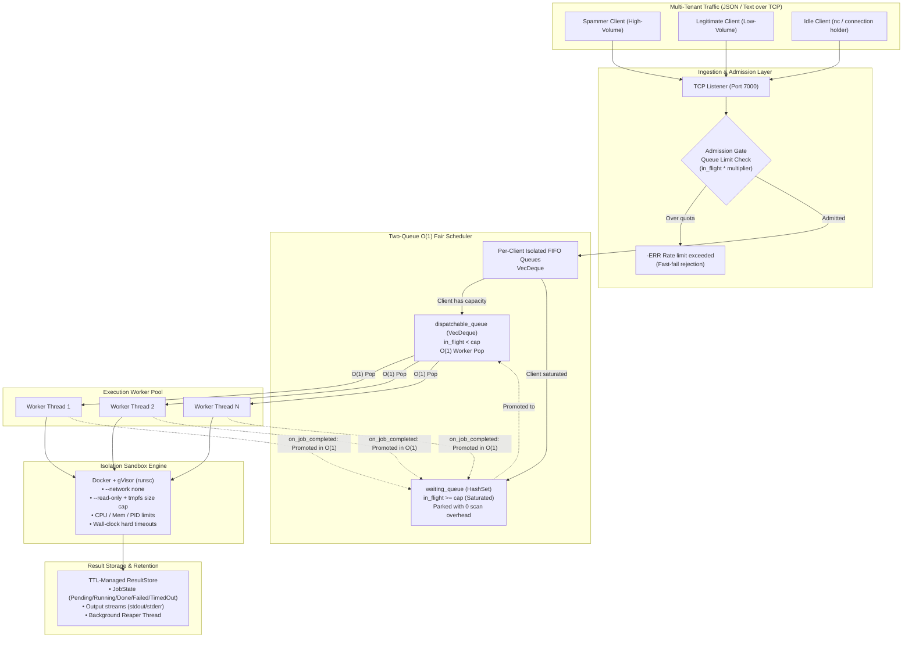
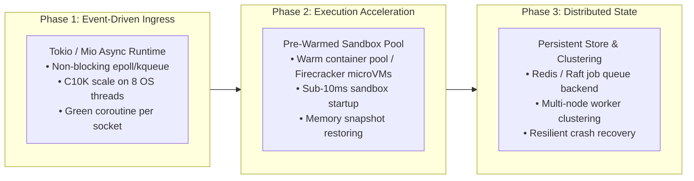

# Sandboxed Job Execution Broker (v2)

High-performance, multi-tenant Remote Code Execution (RCE) engine built in Rust. Users submit untrusted code over TCP, which is scheduled fairly, isolated within ephemeral sandboxes, and monitored under broker-enforced timeouts while clients poll asynchronously for results.

---

## 1. High-Level Architecture

The system decouples network ingestion, multi-tenant scheduling, container sandboxing, and result retention into independent, lock-minimized subsystems:



---

## 2. Core Architectural Pillars & Strengths

### 2.1 Two-Queue $O(1)$ Fair Scheduler
* **Instantaneous $O(1)$ Dispatch:** Workers never scan through an $O(N)$ list of clients skipping saturated tenants under a shared mutex. Workers pop eligible tenants directly from [`dispatchable_queue`](file:///Users/chinmaymahajan/Desktop/IMP%20NOTES%20PDF/RUST/distributed_jobv2/src/scheduler.rs).
* **Zero-Overhead Tenant Saturation:** When a client reaches their concurrent in-flight limit (`max_in_flight_per_client`), they are parked in [`waiting_queue`](file:///Users/chinmaymahajan/Desktop/IMP%20NOTES%20PDF/RUST/distributed_jobv2/src/scheduler.rs). Saturated clients consume **zero worker CPU cycles**.
* **Automatic $O(1)$ Capacity Promotion:** The moment a worker finishes a job, [`on_job_completed()`](file:///Users/chinmaymahajan/Desktop/IMP%20NOTES%20PDF/RUST/distributed_jobv2/src/scheduler.rs) removes the client from [`waiting_queue`](file:///Users/chinmaymahajan/Desktop/IMP%20NOTES%20PDF/RUST/distributed_jobv2/src/scheduler.rs) and promotes them back into [`dispatchable_queue`](file:///Users/chinmaymahajan/Desktop/IMP%20NOTES%20PDF/RUST/distributed_jobv2/src/scheduler.rs) in $O(1)$ time.

### 2.2 Dynamic Admission Control & Bufferbloat Prevention
* **Configurable Backpressure:** Saturated clients can queue pending requests up to a configurable multiplier of their concurrency cap:
  $$\text{Max Allowed Queue Depth} = \text{max\_in\_flight\_per\_client} \times \text{queue\_limit\_multiplier}$$
* **Fast-Fail Memory Protection:** Excess requests beyond this quota are rejected immediately with a descriptive rate limit error before touching the [`ResultStore`](file:///Users/chinmaymahajan/Desktop/IMP%20NOTES%20PDF/RUST/distributed_jobv2/src/store.rs), preventing memory exhaustion and bufferbloat.
* **Empirically Proven Fairness:** Under heavy asymmetric traffic (128 concurrent requests), legitimate tenants experienced **100% completion rates** with an average queue latency of just **1.3s – 1.7s**, while abusive high-frequency spammers were safely bounded.

### 2.3 Non-Blocking Network Ingress
* Client connections submit commands and receive a UUIDv4 `job_id` immediately. Connection threads **never block synchronously** on code compilation or sandbox execution.
* Clients poll on their own schedule via `POLL` or check status via `STATUS`.

### 2.4 Multi-Layered Sandbox Isolation
* **Ephemeral Containers:** Containers run with `--rm` and randomized single-use names.
* **Zero Network Access:** Hard isolation with `--network none`.
* **Resource Caps:** Enforced cgroups via `--memory 128m`, `--cpus 0.5`, `--pids-limit 64`.
* **Filesystem Immutability:** `--read-only` root filesystem paired with a size-limited in-memory `--tmpfs /tmp:rw,noexec,nosuid,size=64m`.
* **Syscall Filtering:** Optional integration with Google's gVisor runtime (`--runtime runsc`).
* **Broker-Enforced Hard Timeout:** A broker supervisor thread monitors wall-clock execution against `timeout_secs`, killing runaway containers or processes and recording `TimedOut`.

### 2.5 Automated Lifecycle Management
* Completed job outputs reside in an in-memory [`ResultStore`](file:///Users/chinmaymahajan/Desktop/IMP%20NOTES%20PDF/RUST/distributed_jobv2/src/store.rs) protected by a Time-To-Live (TTL).
* An asynchronous background reaper periodically sweeps and evicts expired records, preventing silent memory leaks.

---

## 3. Empirical Performance Benchmarks

Stress testing against asymmetric multi-tenant workloads (6 clients, 128 burst requests) comparing the original baseline with the current $O(1)$ two-queue engine:

| Metric | Baseline (Single-Queue) | Current (Two-Queue + Admission Control) | Improvement |
| :--- | :---: | :---: | :---: |
| **Total Test Duration** | `31.20s` | **`13.14s`** | **58% faster** (2.37x speedup) |
| **System-Wide Average Wait** | `15,371.3 ms` | **`3,052.4 ms`** | **5.0x lower latency** |
| **Broker Throughput** | `4.10 req/s` | **`4.79 req/s`** | **+16.8% higher throughput** |
| **Spammer P95 Tail Latency** | `27,861 ms` | **`11,195 ms`** | **59.8% reduction** |
| **Legitimate Tenant Queue Wait** | `2,148.8 ms` | **`1,764.7 ms`** | **Zero starvation** |
| **Legitimate Tenant Success Rate**| `100% (10/10)` | **`100% (10/10)`** | **Protected from noisy neighbors** |

---

## 4. Current Architectural Gaps & Known Limitations

While the broker core and execution engine are robust and fair, the current implementation has several recognized design constraints:

1. **Thread-Per-Connection Ingress Model (The C10K Bottleneck):**
   * *The Problem:* As documented in [`Idle_User_Simulation_Report.md`](file:///Users/chinmaymahajan/Desktop/IMP%20NOTES%20PDF/RUST/distributed_jobv2/Idle_User_Simulation_Report.md), each active TCP connection spawns a dedicated OS thread (`std::thread::spawn`). While physical RSS memory per idle thread is small (~16 KB), 2,000 idle `nc` clients reserve **+4.38 GB of Virtual Address Space (VSZ)** due to default 2 MB stack allocations.
   * *The Impact:* The broker cannot scale to tens of thousands of concurrent idle or long-polling clients without exhausting OS thread handles (`EAGAIN`) or virtual memory limits.
2. **Synchronous Socket I/O:**
   * Connection threads block on `BufReader::read_line()`. A slow-loris client transmitting single bytes with long delays ties up an entire OS thread.
3. **Single-Node In-Memory State:**
   * All scheduler queues, in-flight counters, and [`ResultStore`](file:///Users/chinmaymahajan/Desktop/IMP%20NOTES%20PDF/RUST/distributed_jobv2/src/store.rs) entries reside in the memory of a single process. If the broker restarts, pending jobs and uncollected results are lost.
4. **Container Startup Latency (Cold Starts):**
   * Spawning a fresh Docker container (`docker run --rm`) per job incurs ~300ms–800ms of startup latency. For short micro-benchmarks, container initialization overhead dominates actual execution time.

---

## 5. Future Work & Engineering Roadmap



* **Phase 1: Async Event-Driven Network Ingress (`tokio` / `mio`):**
  Transition from `std::net` thread-per-connection to an asynchronous event reactor. Idle connections will sleep directly in kernel `epoll`/`kqueue` tables, allowing millions of concurrent connections on a fixed pool of threads matching physical CPU cores.
* **Phase 2: Pre-Warmed Container Pools & MicroVMs:**
  Implement a container pooler that keeps paused, pre-warmed sandbox containers ready for immediate execution, dropping cold-start latency from ~500ms to <10ms. Evaluate Firecracker microVMs for hardware-level isolation with container-speed boots.
* **Phase 3: Distributed Job Queuing & Persistence:**
  Decouple the broker ingress nodes from worker nodes using a distributed queue (e.g., Redis Streams, NATS, or a Raft log) and persist result records in durable distributed storage for high availability.
* **Phase 4: Explicit Cancellation Protocol:**
  Add a `CANCEL <job_id>` command allowing clients to abort runaway jobs voluntarily before their wall-clock timeout expires.

---

## 6. Wire Protocol Specification

The broker natively supports two wire protocols over the same TCP listener:

### 6.1 JSON Lines Protocol (Recommended)

#### Submit a Job
**Request:**
```json
{"action": "SUBMIT", "client_id": "alice", "language": "python", "code": "print(2 ** 10)", "stdin": "", "timeout_secs": 5}
```
**Response (Success):**
```json
{"status": "ok", "job_id": "a9844f25-82b5-4b36-a1a2-cb31a61c33f2"}
```
**Response (Rate Limited):**
```json
{"status": "error", "error": "Rate limit exceeded: client 'alice' reached maximum queue capacity of 10 pending jobs (in-flight cap: 2, multiplier: 5)"}
```

#### Poll for Result
**Request:**
```json
{"action": "POLL", "job_id": "a9844f25-82b5-4b36-a1a2-cb31a61c33f2"}
```
**Response:**
```json
{
  "job_id": "a9844f25-82b5-4b36-a1a2-cb31a61c33f2",
  "client_id": "alice",
  "status": "Done",
  "stdout": "1024\n",
  "stderr": "",
  "exit_code": 0,
  "error_message": null,
  "job": {
    "client_id": "alice",
    "language": "python",
    "code": "print(2 ** 10)",
    "stdin": "",
    "timeout_secs": 5
  },
  "created_at_ms": 1711468000000,
  "completed_at_ms": 1711468000050,
  "execution_duration_ms": 50
}
```

---

### 6.2 Redis-Style Text Protocol (for `nc` / `telnet`)

| Command | Syntax | Success Response | Error Response |
|---|---|---|---|
| **Submit Job** | `SUBMIT <client_id> <language> <code...>` | `:<job_id>\r\n` | `-ERR <reason>\r\n` |
| **Poll Job** | `POLL <job_id>` | `+<Status> <json_result>\r\n` | `-ERR Job not found or expired\r\n` |
| **Check Status** | `STATUS <job_id>` | `+<Status>\r\n` | `-ERR Job not found or expired\r\n` |
| **Health Check** | `PING` | `+PONG\r\n` | — |
| **Server Telemetry** | `STATS` | `+OK active_clients=... queued=... in_flight=... stored_results=... dispatchable=... waiting=...\r\n` | — |

---

## 7. Configuration Reference

All settings can be specified via [`Config`](file:///Users/chinmaymahajan/Desktop/IMP%20NOTES%20PDF/RUST/distributed_jobv2/src/config.rs) or environment variables:

| Option | Env Variable | Default | Description |
|---|---|---|---|
| **Bind Address** | `DISTJOB_BIND_ADDR` | `127.0.0.1:7000` | TCP listener bind address |
| **Workers** | `DISTJOB_WORKERS` | `4` | Number of execution worker threads |
| **Per-Client Cap** | `DISTJOB_CLIENT_CAP` | `2` | Max concurrent in-flight jobs per client |
| **Enable Queue Limit** | `DISTJOB_ENABLE_QUEUE_LIMIT` | `true` | Toggles per-client pending queue rate limiting |
| **Queue Multiplier** | `DISTJOB_QUEUE_LIMIT_MULTIPLIER` | `5` | Multiplier defining queue limit: $\text{cap} \times \text{mult}$ |
| **Two-Queue Scheduler**| `DISTJOB_ENABLE_TWO_QUEUE_SCHEDULER` | `true` | Toggles $O(1)$ two-queue engine vs legacy single-queue loop |
| **Sandbox Type** | `DISTJOB_SANDBOX` | `docker` | Sandbox engine: `docker`, `local`, or `mock` |
| **Docker Runtime** | `DISTJOB_DOCKER_RUNTIME` | (none) | e.g. `runsc` for gVisor syscall isolation |
| **Result TTL** | `DISTJOB_TTL_SECS` | `600` | Retention duration for completed job results (seconds) |

---

## 8. Build, Test & Run

### 8.1 Build & Test Suite
```bash
# Compile project
cargo build --release

# Run all unit and integration tests
cargo test
```

### 8.2 Launch Broker
```bash
# Run with Docker sandbox (production mode)
cargo run -- --docker 127.0.0.1:7000

# Run with Local sandbox (fast dev mode without Docker dependency)
cargo run -- --local 127.0.0.1:7000
```

### 8.3 Quick Smoke Test via Netcat
```bash
nc 127.0.0.1 7000
SUBMIT alice python print("Hello from Sandboxed Broker!")
# Response: :<job_id>

STATUS <job_id>
# Response: +Done

POLL <job_id>
# Response: +Done {"job_id": ...}
```

### 8.4 Run Stress Test Suite
```bash
./stress_test.sh
```
