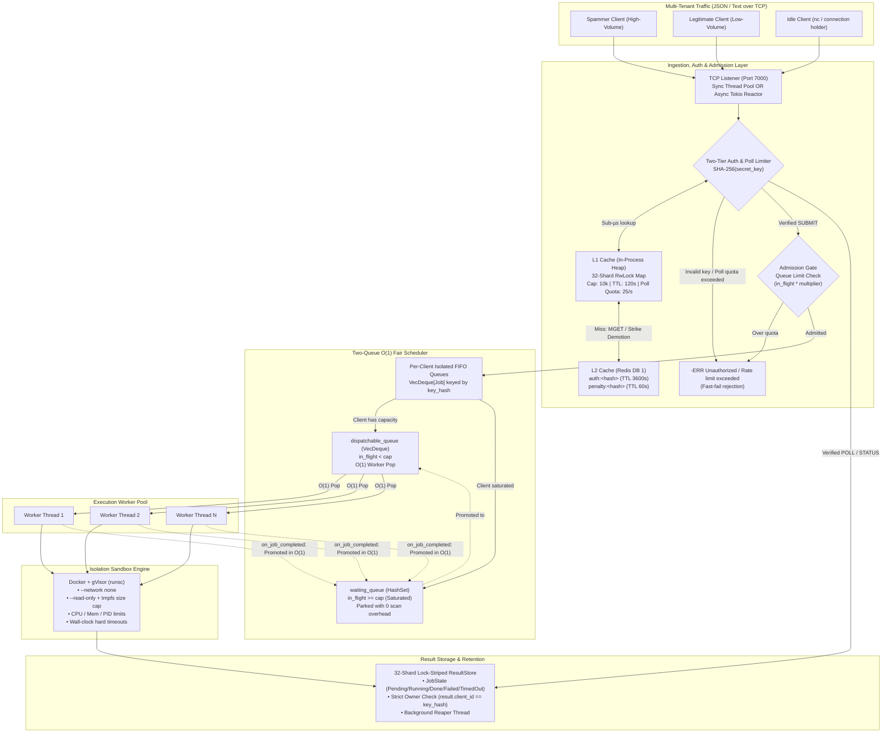
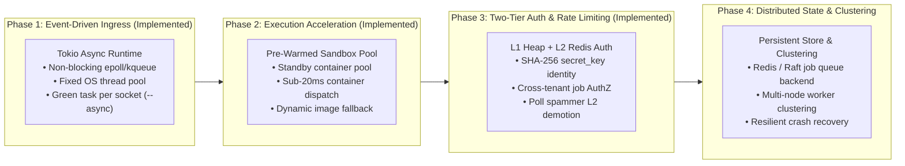

# Sandboxed Job Execution Broker (v2)

High-performance, multi-tenant Remote Code Execution (RCE) engine built in Rust. Users authenticate with server-issued secret keys over TCP, submit untrusted code that is scheduled fairly and isolated within ephemeral sandboxes under broker-enforced timeouts, and poll asynchronously for results under L1/L2 cached rate-limiting.

---

## 1. High-Level Architecture

The system decouples network ingestion, two-tier authentication & poll rate-limiting, multi-tenant scheduling, container sandboxing, and result retention into independent, lock-minimized subsystems:



---

## 2. Core Architectural Pillars & Strengths

### 2.1 Two-Tier Authentication (L1 Heap + L2 Redis), Ownership & Poll Rate-Limiting
* **Server-Issued `secret_key` (Anti-Spoofing):** Clients do not choose their own `client_id`. New clients issue a `REGISTER` command to receive a cryptographically random `secret_key` (`sk_<uuid>`). The broker immediately hashes the key via `SHA-256` (`key_hash = SHA-256(secret_key)`), never storing raw secret keys in memory or Redis, and uses `key_hash` as the internal tenant identifier across the scheduler and result store.
* **L1 (In-Process Heap) + L2 (Redis) Cache Hierarchy ([`src/auth.rs`](src/auth.rs)):**
  * **L1 Heap Cache:** A 32-shard `RwLock<HashMap<String, L1Session>>` living in server process memory with a configurable capacity cap (`l1_max_capacity = 10,000`) and inactivity expiration (`l1_ttl = 120s`). Active users are authenticated in sub-microsecond time with zero network hops.
  * **L2 Redis Cache (`redis://127.0.0.1:6379/1`):** Stores `auth:<key_hash>` in an isolated Redis logical database (`DB 1`) with a longer retention window (`l2_redis_ttl_secs = 3600s`). When an idle user's L1 entry expires, their next request triggers a single-round-trip `MGET auth:<key_hash> penalty:<key_hash>` against Redis and automatically promotes genuine users back into L1.
* **Per-User Polling Quota & Penalty Demotion:**
  * Each L1 session tracks polling frequency within a 1-second window (`max_polls_per_sec = 25`).
  * Exceeding the polling limit rejects the excess poll and increments `violation_strikes`.
  * When a client reaches `max_poll_strikes` (default `3`), the broker **evicts the client from the L1 heap cache** and writes `penalty:<key_hash> = 1` (`EX 60s`) into L2 Redis. While on probation, L2 hits are **not** re-promoted to L1, protecting L1 heap capacity for well-behaved tenants.
* **Strict Cross-Tenant Job Ownership (AuthZ):** Every `POLL` and `STATUS` query verifies `result.client_id == key_hash`, preventing any tenant from inspecting or polling another user's job outputs.
* **Per-Connection `REGISTER` Guard (`peer_auth_map`):** Each accepted TCP connection (`default_client_id = client-<ip>:<port>`) is tracked in `peer_auth_map: RwLock<HashMap<String, bool>>` (initialized to `false` on connect, flipped to `true` on the first `REGISTER`). Calling `REGISTER` / `AUTH` more than once on the same connection is immediately rejected (`Already registered`), preventing a client from minting multiple `secret_key` tokens on one socket to bypass per-client in-flight or polling quotas while still allowing separate connections from the same host IP (distinct ephemeral ports) to register independently.
* **Proactive Idle & Key-Expiry Connection Eviction:** Both the synchronous (`TcpStream::set_read_timeout`) and asynchronous (`tokio::time::timeout`) socket loops enforce a dual deadline of `min(client_idle_timeout, remaining_key_ttl)`. If a client sits idle past `client_idle_timeout` (default `300s`) or its issued `secret_key` reaches `l2_redis_ttl_secs` (`3600s`), the server proactively sends an `ERR` disconnect notice, closes the TCP socket, and guarantees cleanup of `peer_auth_map` via an RAII drop guard (`ConnectionCleanupGuard` / `AsyncConnectionCleanupGuard`).

### 2.2 Two-Queue $O(1)$ Fair Scheduler
* **Instantaneous $O(1)$ Dispatch:** Workers never scan through an $O(N)$ list of clients skipping saturated tenants under a shared mutex. Workers pop eligible tenants directly from [`dispatchable_queue`](src/scheduler.rs).
* **Zero-Overhead Tenant Saturation:** When a client reaches their concurrent in-flight limit (`max_in_flight_per_client`), they are parked in [`waiting_queue`](src/scheduler.rs). Saturated clients consume **zero worker CPU cycles**.
* **Automatic $O(1)$ Capacity Promotion:** The moment a worker finishes a job, [`on_job_completed()`](src/scheduler.rs) removes the client from [`waiting_queue`](src/scheduler.rs) and promotes them back into [`dispatchable_queue`](src/scheduler.rs) in $O(1)$ time.

### 2.3 Dynamic Admission Control & Bufferbloat Prevention
* **Configurable Backpressure:** Saturated clients can queue pending requests up to a configurable multiplier of their concurrency cap:
  $$\text{Max Allowed Queue Depth} = \text{max\_in\_flight\_per\_client} \times \text{queue\_limit\_multiplier}$$
* **Fast-Fail Memory Protection:** Excess requests beyond this quota are rejected immediately with a descriptive rate limit error before touching the [`ResultStore`](src/store.rs), preventing memory exhaustion and bufferbloat.
* **Empirically Proven Fairness:** Under heavy asymmetric traffic (128 concurrent requests), legitimate tenants experienced **100% completion rates** with an average queue latency of just **1.3s – 1.7s**, while abusive high-frequency spammers were safely bounded.

### 2.4 Dual Connection Models: Synchronous vs. Asynchronous Tokio Reactor
The broker supports two interchangeable connection models toggleable at startup via CLI flags or environment variables:
* **Asynchronous Tokio Reactor (`--async` / `DISTJOB_ASYNC=1`):** Uses non-blocking TCP socket multiplexing powered by Tokio (`epoll` on Linux / `kqueue` on macOS) in [`src/server_async.rs`](src/server_async.rs) paired with a multiplexed async Redis connection (`redis::aio::MultiplexedConnection`). Incoming client connections are handled as lightweight cooperative green tasks (~300 bytes each) on a fixed thread pool matching physical CPU cores. Idle clients and polling waits yield execution back to the kernel reactor without consuming dedicated OS threads, fully resolving the C10K connection exhaustion bottleneck.
* **Synchronous Thread-per-Connection (`--sync`, default):** The classic, standalone implementation in [`src/server.rs`](src/server.rs) where each TCP connection is handled by a dedicated OS thread.
* **The Hybrid Reactor Pattern:** In both models, client network ingestion is decoupled from the execution engine. Submissions immediately return an opaque `job_id`, while the heavy container sandboxes execute on dedicated background worker threads ([`WorkerPool`](src/worker.rs)), ensuring high network polling rates never starve container executions and heavy container jobs never freeze the network reactor.
* Clients poll on their own schedule via `POLL` or check status via `STATUS`.

### 2.5 Multi-Layered Sandbox Isolation & Pre-Warmed Acceleration
* **Pre-Warmed "Bake and Burn" Standby Pool:** A background thread maintains idle standby containers ready for instantaneous execution. Containers are claimed in $O(1)$ and burned asynchronously in detached threads after a single use, preserving strict cross-tenant isolation with sub-20ms container dispatch.
* **Pre-Baked Scientific Runtime (`distjob-python:latest`):** Bundles `numpy`, `pandas`, `scipy`, `sympy`, and `requests` with Ahead-of-Time (AOT) `.pyc` bytecode compilation, cutting import times by 3x–5x.
* **Fault-Tolerant Dynamic Image Fallback:** If `distjob-python:latest` is not present on the host, the broker automatically discovers and falls back to `python:3.11-slim` without dropping jobs.
* **Zero Network Access:** Hard air-gapped isolation with `--network none`.
* **Resource Caps:** Enforced cgroups via `--memory 128m`, `--cpus 0.5`, `--pids-limit 64`.
* **Filesystem Immutability:** `--read-only` root filesystem paired with an in-memory `--tmpfs /tmp:rw,noexec,nosuid,size=64m`.
* **Syscall Interception:** Optional integration with Google's gVisor runtime (`--runtime runsc`).
* **Broker-Enforced Hard Timeout:** A broker supervisor thread monitors wall-clock execution against `timeout_secs`, killing runaway containers or processes and recording `TimedOut`.
* **Safe Stdin EOF Transmission:** Decoupled pipe lifecycle ensuring standard input EOF is reliably delivered to container processes.

### 2.6 Automated Lifecycle Management & Lock Sharding
* Completed job outputs reside in an in-memory, lock-striped [`ResultStore`](src/store.rs) partitioned into 32 independent shards, eliminating lock contention between concurrent worker writes and poller reads.
* An asynchronous background reaper periodically sweeps and evicts expired records shard-by-shard, preventing stop-the-world latency spikes and memory leaks.

---

## 3. Empirical Performance Benchmarks

### 3.1 Multi-Tenant Fairness Under Contention (128 Burst Requests)
Stress testing against asymmetric multi-tenant workloads (6 clients, 128 burst requests: 85 High-Freq spammers, 33 Med-Freq, 10 Low-Freq legitimate users):

| Metric | Baseline (Single-Queue) | Current (Two-Queue + Admission Control) | Improvement |
| :--- | :---: | :---: | :---: |
| **Total Test Duration** | `31.20s` | **`13.14s`** | **58% faster** (2.37x speedup) |
| **System-Wide Average Wait** | `15,371.3 ms` | **`3,052.4 ms`** | **5.0x lower latency** |
| **Broker Throughput** | `4.10 req/s` | **`4.79 req/s`** | **+16.8% higher throughput** |
| **Spammer P95 Tail Latency** | `27,861 ms` | **`11,195 ms`** | **59.8% reduction** |
| **Legitimate Tenant Queue Wait** | `2,148.8 ms` | **`1,764.7 ms`** | **Zero starvation** |
| **Legitimate Tenant Success Rate**| `100% (10/10)` | **`100% (10/10)`** | **Protected from noisy neighbors** |

### 3.2 Pre-Warmed Pool Acceleration vs On-Demand Cold Starts (Light Workload)
Benchmarking the impact of the **Pre-Warmed "Bake and Burn" Container Pool** against standard on-demand `docker run`:

| Metric | On-Demand Cold Starts (`docker run`) | Pre-Warmed Pool ("Bake and Burn") | Empirical Improvement |
| :--- | :---: | :---: | :---: |
| **Overall System Throughput** | `4.79 req/s` | **`10.79 req/s`** | **+125.3% Higher Throughput (2.25x)** |
| **Low-Frequency Client Turnaround** | `2,800.0 ms` | **`321.0 ms`** | **88.5% Latency Drop (8.7x faster)** |
| **Total Execution Duration** | `13.14s` | **`2.69s`** | **4.88x Faster Completion** |
| **Completion Rate** | `100%` | **`100% (29/29)`** | **Zero Failures / Zero Drops** |
| **Fairness Multiplier** | `1.4x` | **`4.1x lower latency`** | **Legitimate users bypass spammer backlog** |

---

## 4. Current Architectural Gaps & Known Limitations

While the broker core, authentication layer, and execution engine are robust and fair, the current implementation has several recognized design constraints:

1. **Thread-Per-Connection Ingress in Sync Server [Resolved in Async Server]:**
   * *In Synchronous Mode ([`src/server.rs`](src/server.rs)):* Each active TCP connection spawns a dedicated OS thread (`std::thread::spawn`). While physical RSS memory per idle thread is small (~16 KB), holding thousands of idle connections reserves gigabytes of virtual memory and risks reaching OS thread ceilings (`EAGAIN` / `os error 11`).
   * *In Asynchronous Mode ([`src/server_async.rs`](src/server_async.rs)):* Fully resolved via the Tokio event loop (`--async`), which multiplexes thousands of connections over `epoll`/`kqueue` using a fixed set of threads.
2. **Synchronous Socket I/O (in Sync Model):**
   * Connection threads in the sync server block on `BufReader::read_line()`. A slow-loris client transmitting single bytes with long delays ties up an entire OS thread in sync mode (mitigated when running with `--async`).
3. **Single-Node In-Memory Execution Queues & Result Store:**
   * While authentication keys and penalty states are backed by Redis (L2), the active scheduler queues and [`ResultStore`](src/store.rs) entries reside in the memory of a single broker process. If the broker restarts, pending jobs and uncollected results are lost.
4. **Container Startup Latency (Mitigated by Pre-Warmed Pool):**
   * *Status:* Container initialization overhead is now mitigated by the asynchronous [`PrewarmedContainerPool`](src/sandbox.rs), dropping warm execution startup to sub-20ms. Under sustained bursts that temporarily exhaust the pool, the broker gracefully falls back to on-demand `docker run` (~300ms–800ms). MicroVMs (e.g., AWS Firecracker) represent the subsequent optimization frontier.

---

## 5. Future Work & Engineering Roadmap



* **Phase 1: Async Event-Driven Network Ingress (`tokio`):** *(Implemented in [`src/server_async.rs`](src/server_async.rs))*
  Implemented a non-blocking event-driven reactor powered by Tokio. Connections are handled as green tasks yielding on I/O, allowing thousands of concurrent idle/polling clients on a fixed thread pool.
* **Phase 2: Pre-Warmed Container Pools:** *(Implemented in [`src/sandbox.rs`](src/sandbox.rs))*
  Maintains pre-warmed standby containers ready for immediate execution, dropping cold-start latency from ~500ms to sub-20ms.
* **Phase 3: Two-Tier L1/L2 Authentication & Poll Rate-Limiting:** *(Implemented in [`src/auth.rs`](src/auth.rs))*
  Replaces client-supplied IDs with server-issued `secret_key` tokens hashed via SHA-256 across an in-process L1 heap cache and L2 Redis instance (`DB 1`), enforcing job ownership and demoting polling spammers to L2 probation.
* **Phase 4: Distributed Job Queuing & Persistence:**
  Decouple the broker ingress nodes from worker nodes using a distributed queue (e.g., Redis Streams, NATS, or a Raft log) and persist result records in durable distributed storage for high availability.
* **Phase 5: Explicit Cancellation Protocol:**
  Add a `CANCEL <secret_key> <job_id>` command allowing clients to abort runaway jobs voluntarily before their wall-clock timeout expires.

---

## 6. Wire Protocol Specification

The broker natively supports two wire protocols over the same TCP listener:

### 6.1 JSON Lines Protocol (Recommended)

#### 1. Register to Obtain a Server-Issued `secret_key`
**Request:**
```json
{"action": "REGISTER"}
```
**Response:**
```json
{"status": "ok", "secret_key": "sk_9c8b1a2e4f3d4b5c8a7e6f5d4c3b2a10"}
```

#### 2. Submit a Job
**Request:**
```json
{"action": "SUBMIT", "secret_key": "sk_9c8b1a2e4f3d4b5c8a7e6f5d4c3b2a10", "language": "python", "code": "print(2 ** 10)", "stdin": "", "timeout_secs": 5}
```
**Response (Success):**
```json
{"status": "ok", "job_id": "a9844f25-82b5-4b36-a1a2-cb31a61c33f2"}
```
**Response (Queue Rate Limited):**
```json
{"status": "error", "error": "Rate limit exceeded: client '<sha256_hash>' reached maximum queue capacity of 10 pending jobs (in-flight cap: 2, multiplier: 5)"}
```

#### 3. Poll for Result
**Request:**
```json
{"action": "POLL", "secret_key": "sk_9c8b1a2e4f3d4b5c8a7e6f5d4c3b2a10", "job_id": "a9844f25-82b5-4b36-a1a2-cb31a61c33f2"}
```
**Response:**
```json
{
  "job_id": "a9844f25-82b5-4b36-a1a2-cb31a61c33f2",
  "client_id": "e44e628a3c22186e4e6f7ccab624df3bc121099e96e1492fc3e0d21ebd898392",
  "status": "Done",
  "stdout": "1024\n",
  "stderr": "",
  "exit_code": 0,
  "error_message": null,
  "job": {
    "client_id": "e44e628a3c22186e4e6f7ccab624df3bc121099e96e1492fc3e0d21ebd898392",
    "language": "python",
    "code": "print(2 ** 10)",
    "stdin": "",
    "timeout_secs": 5
  },
  "created_at_ms": 1711468000000,
  "completed_at_ms": 1711468000050,
  "execution_duration_ms": 50
}
```

---

### 6.2 Redis-Style Text Protocol (for `nc` / `telnet`)

| Command | Syntax | Success Response | Error Response |
|---|---|---|---|
| **Register Key** | `REGISTER` (or `AUTH`) | `+sk_<uuid>\r\n` | `-ERR <reason>\r\n` |
| **Submit Job** | `SUBMIT <secret_key> <language> <code...>` | `:<job_id>\r\n` | `-ERR <reason>\r\n` |
| **Poll Job** | `POLL <secret_key> <job_id>` | `+<Status> <json_result>\r\n` | `-ERR Unauthorized / Job not found\r\n` |
| **Check Status** | `STATUS <secret_key> <job_id>` | `+<Status>\r\n` | `-ERR Unauthorized / Job not found\r\n` |
| **Health Check** | `PING` | `+PONG\r\n` | — |
| **Server Telemetry** | `STATS` | `+OK active_clients=... queued=... in_flight=... stored_results=... dispatchable=... waiting=...\r\n` | — |

---

## 7. Configuration Reference

All settings can be specified via [`Config`](src/config.rs) or environment variables:

| Option | Env Variable | Default | Description |
|---|---|---|---|
| **Bind Address** | `DISTJOB_BIND_ADDR` | `127.0.0.1:7000` | TCP listener bind address |
| **Connection Model** | `DISTJOB_ASYNC` | `false` | Toggles Tokio async model (`true`/`1` via `--async`, or `--sync`) |
| **Workers** | `DISTJOB_WORKERS` | `4` | Number of execution worker threads (`-w`) |
| **Per-Client Cap** | `DISTJOB_CLIENT_CAP` | `2` | Max concurrent in-flight jobs per client (`-c`) |
| **Enable Queue Limit** | `DISTJOB_ENABLE_QUEUE_LIMIT` | `true` | Toggles per-client pending queue rate limiting |
| **Queue Multiplier** | `DISTJOB_QUEUE_LIMIT_MULTIPLIER` | `5` | Multiplier defining queue limit: $\text{cap} \times \text{mult}$ |
| **Two-Queue Scheduler**| `DISTJOB_ENABLE_TWO_QUEUE_SCHEDULER` | `true` | Toggles $O(1)$ two-queue engine vs legacy single-queue loop |
| **Pre-Warmed Pool** | `DISTJOB_ENABLE_PREWARMED_POOL` | `true` | Toggles standby pre-warmed container pool |
| **Pool Size** | `DISTJOB_PREWARMED_POOL_SIZE` | `4` | Number of standby containers kept in warm pool (`-p`) |
| **Store Shards** | `DISTJOB_STORE_SHARDS` | `32` | Number of lock-striped shards in ResultStore (`-s`) |
| **Python Image** | `DISTJOB_PYTHON_IMAGE` | `distjob-python:latest` | Docker image with pre-baked libraries |
| **Sandbox Type** | `DISTJOB_SANDBOX` | `docker` | Sandbox engine: `docker`, `local`, or `mock` |
| **Docker Runtime** | `DISTJOB_DOCKER_RUNTIME` | (none) | e.g. `runsc` for gVisor syscall isolation |
| **Result TTL** | `DISTJOB_TTL_SECS` | `600` | Retention duration for completed job results (seconds) |
| **Redis L2 URL** | `DISTJOB_REDIS_URL` | `redis://127.0.0.1:6379/1` | Redis L2 cache connection URI (logical database `1`) |
| **L1 Max Capacity** | `DISTJOB_L1_CAP` | `10000` | Maximum hashed sessions held in the in-process L1 heap cache |
| **L1 Session TTL** | `DISTJOB_L1_TTL_SECS` | `120` | Inactivity TTL (seconds) before an L1 session expires to L2 |
| **L2 Redis TTL** | `DISTJOB_L2_TTL_SECS` | `3600` | Retention TTL (seconds) for `auth:<key_hash>` in Redis L2 |
| **Max Polls / Sec** | `DISTJOB_MAX_POLLS_PER_SEC` | `25` | Maximum allowed `POLL` / `STATUS` requests per second per user |
| **Max Poll Strikes** | `DISTJOB_MAX_POLL_STRIKES` | `3` | Poll quota violations before eviction from L1 to L2 probation |
| **L2 Penalty TTL** | `DISTJOB_L2_PENALTY_SECS` | `60` | Duration (seconds) a demoted spammer is blocked from L1 promotion |
| **Client Idle Timeout** | `DISTJOB_IDLE_TIMEOUT_SECS` | `300` | Max socket inactivity (seconds) before kicking an idle connection |

---

## 8. Build, Test & Run

### 8.1 Build Pre-Baked Sandbox Image
```bash
# Build custom image with NumPy, Pandas, SciPy, SymPy, and precompiled .pyc bytecode
docker build -t distjob-python:latest .
```
> For a line-by-line breakdown of the Dockerfile, layer optimizations, and security profile, see [`docker_image.md`](docker_image.md).

### 8.2 Build & Test Suite
```bash
# Compile project
cargo build --release

# Run all unit and integration tests
cargo test
```

### 8.3 Launch Broker

The broker can run using either the **Asynchronous (Tokio)** or **Synchronous** connection model:

```bash
# Asynchronous Tokio connection model (recommended for high concurrency / production)
cargo run --release -- --async 127.0.0.1:7000

# Asynchronous model with 16 workers and 16 pre-warmed standby containers
cargo run --release -- --async --workers 16 --pool-size 16 127.0.0.1:7000

# Synchronous thread-per-connection model (default)
cargo run --release -- --sync 127.0.0.1:7000

# Run with Local process sandbox (fast dev mode without Docker dependency)
cargo run --release -- --async --local 127.0.0.1:7000
```

### 8.4 Quick Smoke Test via Netcat
```bash
nc 127.0.0.1 7000
REGISTER
# Response: +sk_9c8b1a2e4f3d4b5c8a7e6f5d4c3b2a10

SUBMIT sk_9c8b1a2e4f3d4b5c8a7e6f5d4c3b2a10 python print("Hello from Sandboxed Broker!")
# Response: :<job_id>

STATUS sk_9c8b1a2e4f3d4b5c8a7e6f5d4c3b2a10 <job_id>
# Response: +Done

POLL sk_9c8b1a2e4f3d4b5c8a7e6f5d4c3b2a10 <job_id>
# Response: +Done {"job_id": ...}
```

### 8.5 Run Stress Test Suite
```bash
# Fast validation test (~3-5s, 4 clients, 29 requests)
./stress_test.sh --preset light
# Alternatively via Python test harness:
python3 stress_test.py --preset light

# Standard multi-tenant test (~25-35s)
./stress_test.sh --preset standard

# High-concurrency heavy stress test (6 clients, 128 burst requests)
./stress_test.sh --preset heavy
```
