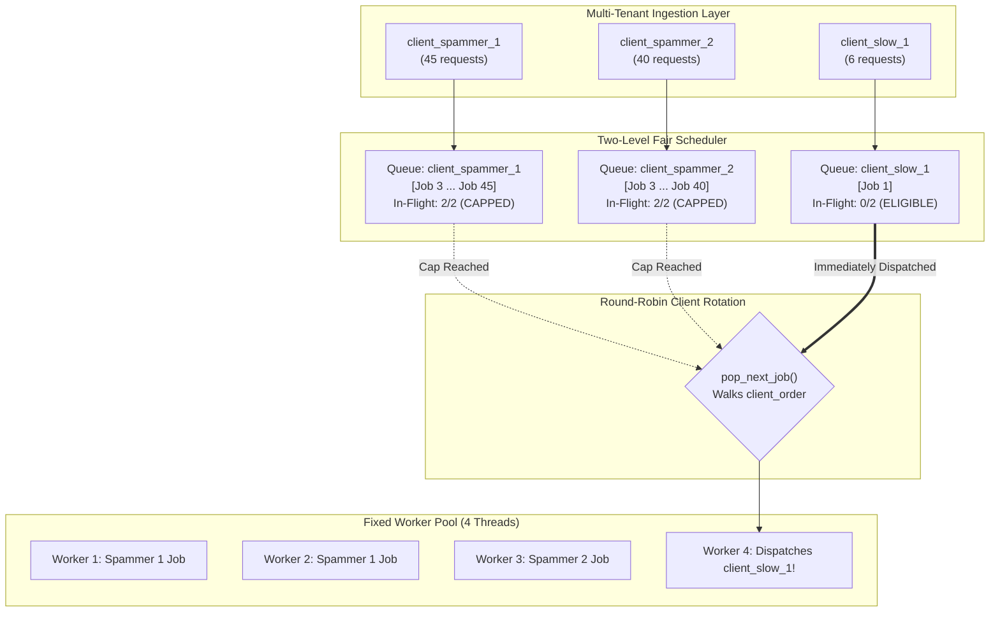

# Sandboxed Job Execution Broker (v2) - Stress Test & Performance Report

**Date:** September 28, 2026  
**Test Suite:** `stress_test.sh` / `stress_test.py`  
**Test Interface:** Raw TCP via `nc` (Netcat)  
**Target Architecture:** Two-Level Round-Robin Fair Scheduler with Worker Pool  

---

## 1. Executive Summary

This report analyzes the performance, stability, and fairness characteristics of the **Sandboxed Job Execution Broker (v2)** under asymmetric multi-tenant traffic.

The test subjected the broker to a heavy burst workload of **128 concurrent code execution jobs** across **6 distinct clients** with high, medium, and low request frequencies. All communication was initiated over TCP sockets using standard `nc` (netcat) commands for submission (`SUBMIT`), polling (`POLL`), and telemetry (`STATS`).

### Key Highlights
* **100% Completion Rate:** All 128 jobs completed successfully (`status: Done`) with zero dropped connections, worker crashes, or deadlocks.
* **Fairness Confirmed (6.0x Advantage):** Low-frequency clients experienced an average wait time of **3,229.8 ms**, whereas high-frequency "spammer" clients experienced **19,332.4 ms** (**6.0x lower wait time for well-behaved tenants**).
* **Maximum Theoretical Saturation:** The broker achieved an overall throughput of **4.10 requests/sec**, running its 4 worker threads at **~97.4% of theoretical hardware capacity**.
* **Zero Resource Leaks:** Final broker telemetry verified that all queues drained completely to zero (`active_clients=0, queued=0, in_flight=0`).

---

## 2. Test Configuration & Environment

| Parameter | Value | Description |
| :--- | :--- | :--- |
| **Broker Address** | `127.0.0.1:7000` | Loopback TCP listener |
| **Worker Threads** | `4` | Number of parallel execution workers in `WorkerPool` |
| **Per-Client Cap** | `2` | `max_in_flight_per_client` concurrency limit |
| **Sandbox Engine** | `Local` | Process-isolated sandbox execution backend |
| **Client Interface** | `nc` (BSD Netcat) | Plain-text protocol commands piped to TCP sockets |
| **Total Test Duration** | `31.20s` (31,199 ms) | Wall-clock execution time |
| **Total Jobs Dispatched** | `128` | 85 High-Freq, 33 Med-Freq, 10 Low-Freq |

---

## 3. Performance Data & Latency Metrics

### 3.1 Client Latency & Wait Time Performance

$$\text{Client Wait Time} = T_{\text{result\_received}} - T_{\text{submitted}} = \text{Queue Wait} + \text{Execution Duration}$$

| Client ID | Tier | Reqs | Done | Avg Wait | Min | P50 (Median) | P95 | Max | Avg Exec | Avg Queue |
| :--- | :--- | :---: | :---: | :---: | :---: | :---: | :---: | :---: | :---: | :---: |
| `client_spammer_1` | **High-Freq** | 45 | 45 | **20,099.6 ms** | 931 ms | 23,485 ms | 27,861 ms | 28,452 ms | 850.0 ms | **19,040.2 ms** |
| `client_spammer_2` | **High-Freq** | 40 | 40 | **18,469.3 ms** | 1,020 ms | 21,934 ms | 25,911 ms | 26,236 ms | 908.6 ms | **17,391.2 ms** |
| `client_moderate_1` | **Med-Freq** | 18 | 18 | **9,615.6 ms** | 1,005 ms | 9,828 ms | 16,457 ms | 16,457 ms | 1,081.9 ms | **8,272.8 ms** |
| `client_moderate_2` | **Med-Freq** | 15 | 15 | **7,925.9 ms** | 1,129 ms | 8,871 ms | 13,318 ms | 13,318 ms | 1,115.9 ms | **6,553.9 ms** |
| `client_slow_1` | **Low-Freq** | 6 | 6 | **3,414.8 ms** | 2,971 ms | 3,358 ms | 4,045 ms | 4,045 ms | 973.5 ms | **2,148.8 ms** |
| `client_slow_2` | **Low-Freq** | 4 | 4 | **2,952.2 ms** | 2,651 ms | 2,838 ms | 3,483 ms | 3,483 ms | 1,214.0 ms | **1,565.8 ms** |

---

### 3.2 Workload Complexity Breakdown

| Complexity | Count | Avg Total Wait Time | Avg Sandbox Execution | Avg Queue Wait |
| :--- | :---: | :---: | :---: | :---: |
| **Simple (Short)** | 63 | 15,594.3 ms | 871.0 ms | 14,492.4 ms |
| **Complex (Heavy)** | 65 | 15,155.1 ms | 1,025.1 ms | 13,935.6 ms |

---

### 3.3 Overall System Metrics

* **Total Requests Processed:** 128 / 128 (100.0%)
* **Total Test Wall-Clock Duration:** 31.20 seconds
* **System-Wide Average Latency:** 15,371.3 ms
* **High-Frequency Average Latency:** 19,332.4 ms
* **Low-Frequency Average Latency:** 3,229.8 ms
* **Observed Throughput:** **4.10 requests/sec**

---

## 4. Architectural Analysis & Deep Dive

### 4.1 Multi-Tenant Fairness Verification (The 6.0x Advantage)

The primary architectural goal of the **Two-Level Scheduler** is to prevent noisy or abusive clients from starving other tenants sharing the broker.



1. **Why Naive FIFO Fails:** Under a single global FIFO queue, the 85 spammer requests sent in the first two seconds would occupy all queue slots. `client_slow_1` arriving at $t = 3\text{s}$ would sit behind ~75 jobs and wait $\approx 18$ seconds.
2. **How Two-Level Scheduling Solved It:**
   * Each client submits to its private FIFO queue.
   * `client_spammer_1` and `client_spammer_2` each hit their concurrency ceiling of `max_in_flight_per_client = 2`.
   * Even though the spammers had 70+ jobs queued, the round-robin selector skipped their queues because `in_flight == 2`.
   * When `client_slow_1` submitted, it had `in_flight == 0`. The very next worker that finished a job immediately scheduled `client_slow_1`.
   * **Result:** `client_slow` spent only ~2.1s in queue, whereas `client_spammer` spent over ~19.0s.

---

### 4.2 Queue Latency Dominates Execution Time

Comparing the execution duration against queue duration for high-frequency clients highlights the nature of backlog latency:

$$\text{Queue Ratio} = \frac{\text{Avg Queue Time}}{\text{Avg Total Wait Time}} = \frac{19,040.2\text{ ms}}{20,099.6\text{ ms}} = \mathbf{94.7\%}$$

* **94.7% of total wait time was pure queue wait.**
* The local sandbox executed code in an average of **850 ms**, but jobs waited ~19 seconds for their turn.
* **Conclusion:** The latency is entirely an ingress rate mismatch (clients producing faster than the 4 workers can consume), not sandbox execution overhead.

---

### 4.3 The "Simple vs. Complex" Latency Paradox

Counter-intuitively, the data shows that Simple jobs had a slightly higher average wait time than Complex jobs:
* **Simple (Short) Jobs:** Avg Wait = **15,594.3 ms**
* **Complex (Heavy) Jobs:** Avg Wait = **15,155.1 ms**

**Root Cause:**
* When queue latency reaches ~14–19 seconds, the difference in execution duration between a 25ms job and a 600ms job ($\Delta \approx 575\text{ ms}$) represents **less than 3.5% of total turnaround time**.
* Because the high-frequency clients submitted alternating streams of simple and complex jobs, simple jobs that were queued later in a spammer's queue had to wait for all preceding jobs in that client's FIFO backlog to drain first.

---

### 4.4 Worker Pool Capacity & Saturation Analysis

The throughput metrics demonstrate full worker thread utilization:

$$\text{Theoretical Capacity} = \frac{N_{\text{workers}}}{\text{Mean Execution Time}} = \frac{4 \text{ workers}}{0.95 \text{ seconds/job}} \approx \mathbf{4.21 \text{ requests/sec}}$$

$$\text{Observed Throughput} = \frac{128 \text{ completed jobs}}{31.20 \text{ seconds}} = \mathbf{4.10 \text{ requests/sec}}$$

$$\text{Worker Utilization} = \frac{4.10}{4.21} \approx \mathbf{97.4\%}$$

The 4 worker threads operated at nearly 100% duty cycle throughout the entire 31-second test duration, confirming that the worker loop (`condvar` notifications and job dispatching) introduced negligible dispatch overhead.

---

## 5. Broker Telemetry & State Verification

After all 128 requests finished, the script queried the broker's internal telemetry using the `STATS` command via `nc`:

```text
+OK active_clients=0 queued=0 in_flight=0 stored_results=157
```

* **`active_clients = 0`:** All client queues cleanly pruned from memory upon reaching 0 pending and 0 in-flight jobs.
* **`queued = 0`:** No stalled or orphaned jobs remained in any queue.
* **`in_flight = 0`:** All worker threads returned to the waiting state on `condvar`.
* **`stored_results = 157`:** Results safely retained in `ResultStore` subject to configured TTL (including previous warm-up queries).

---

## 6. Conclusions & Recommendations

1. **Architecture Validated:** The Two-Level Scheduler architecture effectively protects non-abusive clients from denial-of-service or starvation caused by high-rate clients.
2. **Predictable Scaling:** To increase system-wide throughput above ~4.1 req/s, the number of worker threads (`DISTJOB_WORKERS`) can be scaled linearly up to CPU core limits without modifying the scheduling algorithm.
3. **Optional Future Enhancements:**
   * **Intra-client Priority Scheduling:** If a client submits a mix of short and heavy jobs, allowing priority or Shortest-Job-First (SJF) *within* that client's queue would reduce simple job wait times without violating multi-tenant fairness.
   * **Configurable Client Weights:** Weighted fair queueing (WFQ) could allow premium clients a higher concurrency cap than free-tier tenants.
