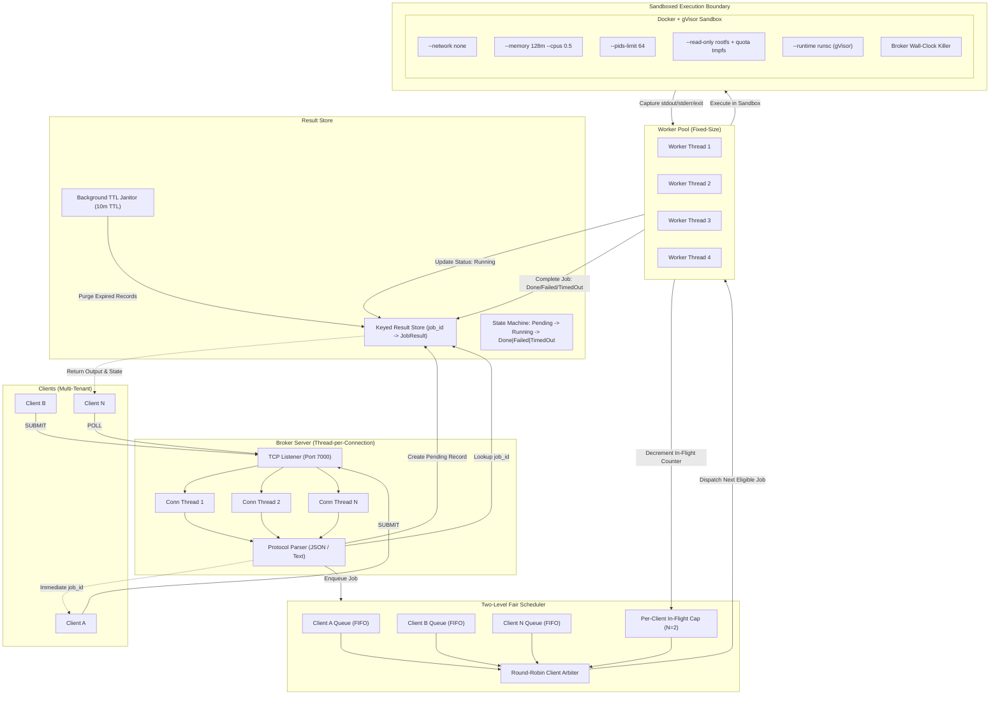
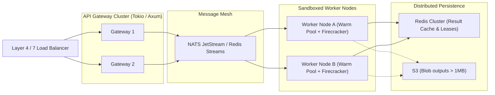

# Sandboxed Job Execution Broker (v2) — Architectural Blueprint & Industry Analysis

## 1. Executive Summary & Problem Formulation

### 1.1 The Challenge of Remote Code Execution (RCE) as a Service
Executing untrusted, user-supplied code remotely is one of the most perilous architectural problems in computer science. Systems such as **LeetCode, HackerRank, Judge0, GitHub Codespaces, AWS Lambda, Google Cloud Run, and Replit** must routinely accept arbitrary code from unknown users and execute it safely, quickly, and fairly.

Building such a system requires resolving four competing engineering tensions:
1. **Security & Host Isolation:** Malicious code will attempt fork bombs, memory exhaustion, network exfiltration, kernel privilege escalation, filesystem tampering, and container breakout. The host must remain strictly isolated.
2. **Fairness & Multi-Tenancy:** A single active or misbehaving client submitting thousands of long-running jobs must not starve other users sharing the infrastructure (the "noisy neighbor" problem).
3. **Execution Decoupling & Reliability:** Sandboxed execution takes unpredictable wall-clock time (milliseconds to minutes). Network connections must never block synchronously on execution, and worker crashes or runaway jobs must be handled deterministically.
4. **Lifecycle & Resource Management:** Submissions and execution outputs cannot reside in memory indefinitely. Abandoned results must expire cleanly to avoid silent memory exhaustion.

### 1.2 The Evolution from v1 (`DispatchLite`) to v2
The predecessor to this system (`distributed_job` / `DispatchLite`) was an early exploration into job brokers, but possessed fundamental structural bottlenecks:
- **Synchronous Lock Contention:** A global mutex was acquired across connection handling and command execution, serializing work and blocking client sockets.
- **Race Condition in Job Fetching:** Workers checked `is_empty()` and subsequently called `fetch()` in separate critical sections, triggering fatal panics under concurrent load (`pop_front().unwrap()`).
- **Zero Sandboxing / Severe Security Vulnerability:** Code was executed directly on the host using `subprocess.run(cmd, shell=True)` with root/user privileges, offering no isolation, no limits, and open network access.
- **No Concurrency Caps or Tenant Isolation:** A single client could flood the queue and consume all worker threads.
- **Memory Leaks & Missing Fail States:** Worker failures were swallowed silently, jobs lingered in `Running` forever, and completed records had no Time-To-Live (TTL).

**Version 2 (`distributed_jobv2`)** was designed from the ground up to solve every architectural defect of v1 by implementing **asynchronous non-blocking network ingestion, a fair two-level scheduler, ephemeral container sandboxing with gVisor isolation, broker-enforced timeouts, and a TTL-managed result store**.

---

## 2. High-Level Architecture & End-to-End Flow



---

## 3. Detailed Component Methodology

### 3.1 Networking Layer: Thread-per-Connection vs. Async Event Loop
The server implementation lives in [`src/server.rs`](file:///Users/chinmaymahajan/Desktop/IMP%20NOTES%20PDF/RUST/distributed_jobv2/src/server.rs).

#### Methodology:
1. `TcpListener` binds to the configured host and port (default `127.0.0.1:7000`).
2. Each incoming socket is immediately handed off to an independent OS thread (`thread::spawn`).
3. The connection thread performs line-buffered I/O using `BufReader` and `TcpStream`.
4. **Execution is completely decoupled from networking:**
   - On `SUBMIT`: A new UUIDv4 `job_id` is generated. A `Pending` entry is created in [`ResultStore`](file:///Users/chinmaymahajan/Desktop/IMP%20NOTES%20PDF/RUST/distributed_jobv2/src/store.rs), the job is submitted to [`TwoLevelScheduler`](file:///Users/chinmaymahajan/Desktop/IMP%20NOTES%20PDF/RUST/distributed_jobv2/src/scheduler.rs), and the response containing `job_id` is written back immediately. **The thread never blocks on job execution.**
   - On `POLL` / `STATUS`: The thread queries the [`ResultStore`](file:///Users/chinmaymahajan/Desktop/IMP%20NOTES%20PDF/RUST/distributed_jobv2/src/store.rs) in $O(1)$ time and returns the current state and execution payload.

#### Rationale & Trade-offs:
- **Simplicity & Predictability:** Thread-per-connection avoids the conceptual and runtime complexity of an async runtime (`tokio`, `mio`) during early prototype phases.
- **Independence:** If a client connection experiences network stalls or slow read/write bandwidth, it only affects that individual client thread; other clients and workers remain unaffected.
- **The C10K Boundary:** OS threads allocate a dedicated stack (typically 2MB–8MB virtual memory). While suitable for hundreds or a few thousand connections, scaling to 100,000+ idle persistent connections requires transitioning to an event-driven async loop (discussed in Section 4).

---

### 3.2 Two-Level Scheduler: Fairness, Isolation, and Hard Caps
The scheduling core lives in [`src/scheduler.rs`](file:///Users/chinmaymahajan/Desktop/IMP%20NOTES%20PDF/RUST/distributed_jobv2/src/scheduler.rs).

#### The Problem with Naive FIFO:
In a naive global FIFO queue, if Client $A$ submits 1,000 slow batch jobs followed by Client $B$ submitting 1 critical quick job, Client $B$ experiences severe head-of-line blocking and starves until Client $A$'s backlog clears.

#### The Two-Level Scheduling Algorithm:
The broker implements a two-level hierarchical scheduling policy:
1. **Level 1 (Per-Client FIFO Isolation):**
   Each client possesses an independent FIFO queue (`VecDeque<Job>`). Client $A$'s submissions can never displace, delay, or interleave ahead of Client $B$'s submissions within their own queues.
2. **Level 2 (Round-Robin Inter-Client Dispatch with Concurrency Cap):**
   Active clients are arranged in a circular sequence (`VecDeque<String>` order list).
   When a worker thread requests the next job, the scheduler inspects clients in round-robin order:
   $$\text{Client is eligible if: } \text{in\_flight}(c) < N \quad \land \quad \neg \text{queue}(c).\text{is\_empty}()$$
   where $N$ is `max_in_flight_per_client` (default: 2).

```
   Queue Ring: [ Client A, Client B, Client C ]
                         │
                         ▼
        Check Client A: in_flight = 2 == N (Cap reached) ──▶ SKIP
                         │
                         ▼
        Check Client B: in_flight = 0 < N & has jobs ─────▶ DISPATCH B1
                         │                                  (B moves to back)
                         ▼
        Updated Ring: [ Client C, Client A, Client B ]
```

3. **In-Flight Concurrency Throttling:**
   - On dispatch: `client_in_flight[c] += 1`.
   - On completion: `client_in_flight[c] -= 1`.
   - **Guaranteed Capacity Bound:** No client can ever monopolize more than:
     $$\text{Max Capacity Share} = \frac{N}{\text{Total Workers}}$$
     With 4 workers and $N=2$, a single client can consume at most 50% of the execution pool, leaving the remainder available for other tenants.
4. **Starvation Freedom:**
   Whenever an active client finishes a job, or a new client submits a job, `Condvar::notify_one()` or `notify_all()` awakens waiting workers to evaluate the round-robin ring.

---

### 3.3 Sandboxed Execution Engine (Defense-in-Depth)
The sandboxing subsystem lives in [`src/sandbox.rs`](file:///Users/chinmaymahajan/Desktop/IMP%20NOTES%20PDF/RUST/distributed_jobv2/src/sandbox.rs).

#### The Threat Vector Matrix:
| Attack Vector | Malicious Mechanism | Broker Mitigation |
|---|---|---|
| **Data Exfiltration** | Sockets, DNS tunneling, HTTP curl | `--network none` (Virtual interface disabled) |
| **Host DoS / Infinite Loops** | `while True: pass` consuming 100% CPU | `--cpus 0.5` + Broker Wall-Clock Timeout (`kill`) |
| **Memory Exhaustion (OOM)** | Allocating gigabytes in array/heap | `--memory 128m` (cgroups limit; swap disabled) |
| **Fork Bomb** | `:(){ :\|:& };:` or `os.fork()` recursion | `--pids-limit 64` (Restricts kernel task creation) |
| **Disk Filling Attack** | Writing gigabytes to `/tmp` | `--read-only` rootfs + `--tmpfs /tmp:size=64m` |
| **Container Escape** | Kernel 0-day exploits via raw syscalls | `gVisor` (`--runtime runsc`) syscall interception |
| **Cross-Tenant State Leak** | Files written by User A read by User B | Ephemeral single-use containers (`--rm`) |
| **Docker Daemon Hijack** | Mounting `/var/run/docker.sock` | Docker socket is **never mounted** inside container |

#### Execution Mechanics & Code Injection:
1. **Isolated Temp Staging:** For each job, the broker generates a UUID-keyed host directory `/tmp/distjob-<uuid>/`.
2. **Code Write:** The script is written to a designated file (`script.py`, `script.sh`, `script.js`).
3. **Mounting:** The folder is mounted into the container as a **read-only volume**:
   ```bash
   docker run -i --rm \
     --name distjob-<uuid> \
     --network none \
     --memory 128m \
     --cpus 0.5 \
     --pids-limit 64 \
     --read-only \
     --tmpfs /tmp:rw,noexec,nosuid,size=64m \
     -v /tmp/distjob-<uuid>:/code:ro \
     [--runtime runsc] \
     python:3.11-slim python3 /code/script.py
   ```
4. **Standard Input & Output Streams:**
   - Stdin is piped to the child process and closed to trigger EOF.
   - Stdout and Stderr are drained concurrently in dedicated background reader threads up to a strict cap (`MAX_OUTPUT_BYTES = 1 MB`) to prevent pipe buffer deadlocks and memory exhaustion from infinite print loops.
5. **Broker-Enforced Wall-Clock Timeout:**
   The broker checks execution elapsed time. If the deadline expires:
   - `docker kill distjob-<uuid>` is executed immediately.
   - The CLI child process is killed (`child.kill()`).
   - The job is recorded as `JobState::TimedOut`.
   - Host staging directory `/tmp/distjob-<uuid>` is purged.

---

### 3.4 Result Persistence & State Machine
The result management lives in [`src/store.rs`](file:///Users/chinmaymahajan/Desktop/IMP%20NOTES%20PDF/RUST/distributed_jobv2/src/store.rs).

#### Explicit Job State Machine:
```
           ┌───────────┐
           │  Pending  │ (Job enqueued, awaiting worker)
           └─────┬─────┘
                 │ Worker picks up job
                 ▼
           ┌───────────┐
           │  Running  │ (Executing in sandbox)
           └─────┬─────┘
                 │
      ┌──────────┼──────────┐
      │ Exit 0   │ Exit >0  │ Timeout exceeded
      ▼          ▼          ▼
 ┌─────────┐┌─────────┐┌──────────┐
 │  Done   ││ Failed  ││ TimedOut │
 └─────────┘└─────────┘└──────────┘
```

#### Memory Management with TTL:
Without an expiration mechanism, clients that submit jobs but never poll would cause unbound memory growth.
- Every entry in `ResultStore` is stamped with an `expires_at = Instant::now() + TTL` (default: 600s / 10 minutes).
- **Two-Tier Purging:**
  - **Passive Purge on Read:** If `get(job_id)` is invoked after expiry, the entry is immediately evicted and returns `None`.
  - **Active Background Janitor:** A lightweight background thread awakens every `cleanup_interval` (default: 30s) and scans the store, pruning stale entries.
- **Read-Write Locking (`RwLock`):** Read-heavy `POLL` requests acquire shared locks simultaneously without blocking one another.

---

### 3.5 Dual Wire Protocol: JSON Lines + Text Mode
Defined in [`src/protocol.rs`](file:///Users/chinmaymahajan/Desktop/IMP%20NOTES%20PDF/RUST/distributed_jobv2/src/protocol.rs).

1. **JSON Lines Protocol (`NDJSON`):**
   - Ideal for production clients, automated test suites, and programmatic SDKs.
   - Allows multiline source code, embedded JSON payloads, and arbitrary characters without fragile escaping.
   - Example Submit:
     ```json
     {"action": "SUBMIT", "client_id": "alice", "language": "python", "code": "print(2**10)", "stdin": "", "timeout_secs": 5}
     ```
   - Example Poll Response:
     ```json
     {"job_id": "90e2-...", "client_id": "alice", "status": "Done", "stdout": "1024\n", "stderr": "", "exit_code": 0, "execution_duration_ms": 42}
     ```
2. **Text Command Protocol (Redis-Style):**
   - Optimized for human debugging via `nc`, `telnet`, or simple shell scripts:
     - `SUBMIT <client_id> <language> <code...>` $\rightarrow$ `:<job_id>\r\n`
     - `STATUS <job_id>` $\rightarrow$ `+Done\r\n`
     - `POLL <job_id>` $\rightarrow$ `+Done {json_result}\r\n`
     - `PING` $\rightarrow$ `+PONG\r\n`
     - `STATS` $\rightarrow$ `+OK active_clients=... queued=... in_flight=...\r\n`

---

## 4. Industry Standards & Architectural Alternatives

How does our architecture compare to solutions used at scale across major cloud and code execution platforms?

### 4.1 Sandboxing Technologies Comparison

| Technology | Isolation Mechanism | Cold-Start Overhead | Security Strength | Representative Systems |
|---|---|---|---|---|
| **Linux Namespaces / cgroups (`runc`)** | OS kernel boundary (chroot, namespaces, cgroups) | 100ms – 500ms | **Moderate** (Shared kernel; vulnerable to kernel 0-day exploits) | Standard Docker, Kubernetes |
| **User-Space Kernel Interception (`gVisor` / `runsc`)** | Intercepts application syscalls via `Sentry` user-space kernel | 150ms – 700ms | **High** (Application never interacts directly with host kernel) | Google Cloud Run, Cloud Functions, **distributed_jobv2** |
| **System Call Filtering (`nsjail` / `isolate`)** | Lightweight Linux namespace + rigid `seccomp-bpf` whitelist | 5ms – 20ms | **High** (Restricts syscall surface to minimal safe set) | LeetCode, Codeforces, IOI, Judge0 |
| **MicroVMs (`Firecracker` / `Cloud Hypervisor`)** | Hardware-assisted virtualization (KVM) with minimal device models | 5ms – 30ms (snapshot) 100ms (cold) | **Maximum** (Full hardware virtualization barrier) | AWS Lambda, AWS Fargate, Fly.io |
| **WebAssembly Sandboxing (`Wasmtime` / `V8`)** | Software fault isolation / capability-based WASI bytecode | < 1ms | **Very High** (Safe memory model, but requires Wasm compilation) | Cloudflare Workers, Fastly Compute@Edge |

#### Why gVisor for this Architecture?
For arbitrary untrusted code execution (C, Python, Bash, Node.js), requiring users to pre-compile to WebAssembly is too restrictive. Standard Docker alone leaves the host kernel vulnerable to privilege escalation. `gVisor` (`runsc`) strikes the optimal balance: it runs standard OCI containers and unmodified language binaries while interposing a secure user-space kernel between the untrusted code and the host OS.

---

### 4.2 Multi-Tenant Scheduling Algorithms

| Algorithm | Fairness Strategy | Overhead | Strengths & Weaknesses |
|---|---|---|---|
| **Global FIFO** | Arrival order | $O(1)$ | ❌ High vulnerability to starvation and noisy neighbors. |
| **Two-Level FIFO + Round-Robin (Our System)** | FIFO per client, Round-Robin across active clients with concurrency cap | $O(C)$ where $C$ is active clients | ✅ Simple, starvation-free, strictly bounds tenant capacity share. |
| **Deficit Round Robin (DRR)** | Quantum-based byte/time allowance per tenant | $O(1)$ amortized | ✅ Accounts for varying job weights / runtimes, but higher state tracking complexity. |
| **Dominant Resource Fairness (DRF)** | Equalizes dominant share across multiple dimensions (CPU, RAM, Disk) | $O(C \log C)$ | ✅ Optimal for heterogeneous multi-resource clusters (used in Apache Mesos / Kubernetes). |

---

### 4.3 Networking & IPC Topologies

| Architecture | Concurrency Limit | Complexity | Best Fit |
|---|---|---|---|
| **Thread-per-Connection (Current)** | ~1,000 – 5,000 connections | Low | Prototypes, internal services, trusted VPC clients |
| **Async Reactor (`tokio` / `epoll`)** | 100,000+ connections | Medium | High-concurrency public APIs, microservices |
| **Decoupled Queue Broker (NATS / Redis / Kafka)** | Millions of connections (distributed) | Higher (Distributed state) | Production clusters with independent autoscaling worker fleets |

---

## 5. Failure Modes, Edge Cases, and Mitigations

### 5.1 Infinite Loops & Unresponsive Processes
- **Risk:** User submits `while True: pass` or `time.sleep(100000)`.
- **Mitigation:** The broker enforces a hard deadline using `std::time::Instant`. When exceeded, `docker kill` is dispatched directly to the Docker engine, terminating the container at the OS/hypervisor level regardless of whether the internal process ignores `SIGTERM`.

### 5.2 Output Bombs (Stdout / Stderr Flooding)
- **Risk:** User submits `while True: print("A" * 1000000)`, attempting to exhaust broker memory via pipe buffering.
- **Mitigation:** Output capture uses `Read::take(MAX_OUTPUT_BYTES)` (capped at 1 MB). Any data generated beyond 1 MB is dropped, safeguarding host RAM while preserving the initial debugging diagnostics for the user.

### 5.3 Abandoned Jobs & Disconnected Sockets
- **Risk:** A user submits 100 jobs and immediately closes the TCP socket.
- **Mitigation:** The connection thread terminates cleanly without aborting the background job. The worker executes the task, publishes the result to `ResultStore`, and the background TTL reaper automatically evicts the data after 10 minutes if no client reconnects to poll it.

### 5.4 Rapid Tenant ID Churn
- **Risk:** Malicious scripts generating randomized `client_id` strings on every submission could bloat scheduler maps.
- **Mitigation:** In `TwoLevelScheduler::on_job_completed`, when a client's queue reaches 0 and its `in_flight` counter drops to 0, the client entry is pruned from the hash map and order ring, ensuring memory usage is proportional to *active* clients rather than historical clients.

---

## 6. Production Roadmap & Future Enhancements

If expanding this architecture to a multi-node, high-throughput commercial deployment:



1. **Warm Sandbox Pools:**
   - *Current limitation:* Spawning a cold Docker container takes 200ms–800ms.
   - *Enhancement:* Maintain a pre-warmed pool of paused or pre-initialized sandbox containers ready to receive code instantaneously, replenishing in the background.
2. **MicroVM Transition (AWS Firecracker):**
   - Replace container runtimes with lightweight hardware microVMs booting in under 15ms with full guest-kernel isolation.
3. **Async Event-Driven Ingestion:**
   - Migrate connection handling from `thread::spawn` to `tokio` to handle 50,000+ simultaneous persistent poll connections with minimal memory footprint.
4. **Worker Heartbeats & Lease-Based Reclaiming:**
   - If a physical worker machine suffers sudden hardware failure mid-execution, a distributed lease coordinator (etcd or Redis Redlock) detects the missed heartbeat and automatically returns the `Running` job to `Pending` for another worker node to resume.
