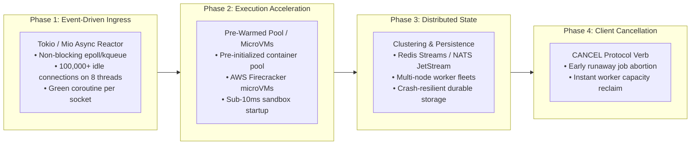

# Sandboxed Job Execution Broker (v2) — Architectural Blueprint & Industry Analysis

## 1. Executive Summary & Problem Formulation

### 1.1 The Challenge of Remote Code Execution (RCE) as a Service
Executing untrusted, user-supplied code remotely is one of the most perilous architectural problems in computer science. Systems such as **LeetCode, HackerRank, Judge0, GitHub Codespaces, AWS Lambda, Google Cloud Run, and Replit** must routinely accept arbitrary code from unknown users and execute it safely, quickly, and fairly.

Building such a system requires resolving four competing engineering tensions:
1. **Security & Host Isolation:** Malicious code will attempt fork bombs, memory exhaustion, network exfiltration, kernel privilege escalation, filesystem tampering, and container breakout. The host must remain strictly isolated.
2. **Fairness & Multi-Tenancy:** A single active or misbehaving client submitting thousands of long-running jobs must not starve other users sharing the infrastructure (the "noisy neighbor" problem).
3. **Execution Decoupling & Reliability:** Sandboxed execution takes unpredictable wall-clock time (milliseconds to minutes). Network connections must never block synchronously on execution, and worker crashes or runaway jobs must be handled deterministically.
4. **Lifecycle & Resource Management:** Submissions and execution outputs cannot reside in memory indefinitely. Abandoned results must expire cleanly to avoid silent memory exhaustion.

### 1.2 The Evolution from v1 (`DispatchLite`) to v2
The predecessor to this system (`distributed_job` / `DispatchLite`) was an early exploration into job brokers, but possessed fundamental structural bottlenecks:
- **Synchronous Lock Contention:** A global mutex was acquired across connection handling and command execution, serializing work and blocking client sockets.
- **Race Condition in Job Fetching:** Workers checked `is_empty()` and subsequently called `fetch()` in separate critical sections, triggering fatal panics under concurrent load (`pop_front().unwrap()`).
- **Zero Sandboxing / Severe Security Vulnerability:** Code was executed directly on the host using `subprocess.run(cmd, shell=True)` with root/user privileges, offering no isolation, no limits, and open network access.
- **No Concurrency Caps or Tenant Isolation:** A single client could flood the queue and consume all worker threads.
- **Memory Leaks & Missing Fail States:** Worker failures were swallowed silently, jobs lingered in `Running` forever, and completed records had no Time-To-Live (TTL).

**Version 2 (`distributed_jobv2`)** was designed from the ground up to solve every architectural defect of v1 by implementing **non-blocking network ingestion, a two-queue $O(1)$ fair scheduler with backpressure admission control, ephemeral container sandboxing with gVisor syscall isolation, broker-enforced hard timeouts, and a TTL-managed result store**.

---

## 2. High-Level Architecture & End-to-End Flow

```mermaid
flowchart TD
    subgraph Clients["Clients (Multi-Tenant Ingress)"]
        CA["Spammer Client (High-Volume)"]
        CB["Moderate Client (Mid-Volume)"]
        CC["Legitimate Client (Low-Volume)"]
    end

    subgraph Server["Broker Server Layer"]
        TCP["TCP Listener (Port 7000)"]
        ConnThreads["Connection Threads (Thread-per-Connection)"]
        Proto["Protocol Parser (JSON Lines / Text)"]
    end

    subgraph Admission["Dynamic Admission Gate"]
        Gate{"Per-Client Queue Limit Check<br/>queued < (in_flight_cap * multiplier)"}
        Reject["Fast-Fail: -ERR Rate limit exceeded<br/>(Returns immediately; 0 worker cost)"]
    end

    subgraph Scheduling["Two-Queue O(1) Fair Scheduler"]
        DQ["dispatchable_queue (VecDeque)<br/>in_flight < cap<br/>• O(1) Instant Worker Pop<br/>• Round-Robin Inter-Tenant Fairness"]
        WQ["waiting_queue (HashSet)<br/>in_flight >= cap (Saturated)<br/>• 0% Worker Scan Overhead<br/>• Promoted on completion in O(1)"]
        PerClientQ["Per-Client Isolated FIFO Queues<br/>client_queues: HashMap<String, VecDeque<Job>>"]
    end

    subgraph Workers["Worker Pool (Fixed-Size)"]
        W1["Worker Thread 1"]
        W2["Worker Thread 2"]
        W3["Worker Thread 3"]
        W4["Worker Thread 4"]
    end

    subgraph SandboxEnv["Sandboxed Execution Boundary"]
        subgraph DockerGVisor["Docker + gVisor Sandbox"]
            S1["--network none (Hard network isolation)"]
            S2["--memory 128m --cpus 0.5 (cgroups caps)"]
            S3["--pids-limit 64 (Fork-bomb defense)"]
            S4["--read-only rootfs + 64m tmpfs quota"]
            S5["--runtime runsc (gVisor user-space kernel)"]
            S6["Broker Wall-Clock Timeout Supervisor"]
        end
    end

    subgraph Storage["Result Store & Lifecycle"]
        RS["Keyed Result Store (job_id -> JobResult)"]
        StateMach["State Machine: Pending -> Running -> Done|Failed|TimedOut"]
        Reaper["Background TTL Janitor (Sweep stale entries)"]
    end

    CA & CB & CC -->|SUBMIT / POLL / STATUS| TCP
    TCP --> ConnThreads
    ConnThreads --> Proto

    Proto -->|SUBMIT request| Gate
    Gate -->|"Over quota"| Reject
    Gate -->|"Admitted"| PerClientQ

    PerClientQ -->|"in_flight < cap"| DQ
    PerClientQ -->|"in_flight >= cap"| WQ
    Proto -.->|"Immediate job_id (Non-blocking)"| ConnThreads

    DQ -->|"O(1) Pop Next Eligible Job"| Workers
    Workers -->|Update Status: Running| RS
    Workers -->|Execute Script in Container| SandboxEnv
    SandboxEnv -->|Capture stdout/stderr (1MB cap)| Workers
    Workers -->|Record Result: Done/Failed/TimedOut| RS

    Workers -.->|"on_job_completed: Slot opened"| WQ
    WQ -.->|"Promoted to"| DQ
    Proto -->|POLL / STATUS: O(1) lookup| RS
    Reaper -->|Purge Expired Records (TTL)| RS
```

---

## 3. Detailed Component Methodology

### 3.1 Networking Layer: Ingress Mechanics & The Concurrency Model
The server implementation lives in [`src/server.rs`](file:///Users/chinmaymahajan/Desktop/IMP%20NOTES%20PDF/RUST/distributed_jobv2/src/server.rs).

#### Methodology:
1. `TcpListener` binds to the configured host and port (default `127.0.0.1:7000`).
2. Each incoming socket is immediately handed off to an independent OS thread (`thread::spawn`).
3. The connection thread performs line-buffered I/O using `BufReader` and `TcpStream`.
4. **Execution is completely decoupled from networking:**
   - On `SUBMIT`: A new UUIDv4 `job_id` is generated. If the client passes the admission gate, a `Pending` entry is created in [`ResultStore`](file:///Users/chinmaymahajan/Desktop/IMP%20NOTES%20PDF/RUST/distributed_jobv2/src/store.rs), the job is enqueued in [`TwoLevelScheduler`](file:///Users/chinmaymahajan/Desktop/IMP%20NOTES%20PDF/RUST/distributed_jobv2/src/scheduler.rs), and the response containing `job_id` is written back immediately. **The thread never blocks on sandbox execution.**
   - On `POLL` / `STATUS`: The thread queries [`ResultStore`](file:///Users/chinmaymahajan/Desktop/IMP%20NOTES%20PDF/RUST/distributed_jobv2/src/store.rs) in $O(1)$ time and returns the current state and execution payload.

#### Empirical Findings & The Thread-per-Connection Bottleneck:
During our live 2,000-connection benchmark (documented in [`Idle_User_Simulation_Report.md`](file:///Users/chinmaymahajan/Desktop/IMP%20NOTES%20PDF/RUST/distributed_jobv2/Idle_User_Simulation_Report.md)), we analyzed the resource profile of the thread-per-connection model:
* **The "16 KB" Idle Memory Reality:** Physical resident memory (RSS) only increased by ~33.6 MB (~16.8 KB per idle thread) because threads only dirtied top stack pages before blocking on `read_line()`.
* **Virtual Address Space (VSZ) Surge:** Virtual memory surged by **+4.38 GB** ($400.8\text{ GB} \rightarrow 405.2\text{ GB}$) because modern 64-bit operating systems allocate a default **2 MB stack reservation** per OS thread.
* **Architectural Trade-Off:** While thread-per-connection is simple, robust, and completely isolates network stalls to single connections, scaling past 5,000–10,000 concurrent persistent connections requires transitioning to an event-driven reactor (`tokio` / `mio`), as analyzed in Section 4.

---

### 3.2 Two-Queue $O(1)$ Fair Scheduler with Backpressure Admission
The scheduling engine lives in [`src/scheduler.rs`](file:///Users/chinmaymahajan/Desktop/IMP%20NOTES%20PDF/RUST/distributed_jobv2/src/scheduler.rs).

#### 3.2.1 The Two-Queue Invariant Architecture
In naive round-robin schedulers with concurrency caps, workers iterate over an $O(N)$ list of all clients, skipping saturated clients one-by-one under a global lock. Under heavy asymmetric load, workers waste significant CPU cycles skipping unrunnable tenants.

Version 2 eliminates this bottleneck by maintaining two strictly disjoint sets:

```rust
struct InnerScheduler {
    client_queues: HashMap<String, VecDeque<Job>>,
    client_in_flight: HashMap<String, usize>,
    max_in_flight_per_client: usize,

    // ACTIVE POOL: Clients with pending jobs AND in_flight < max
    dispatchable_queue: VecDeque<String>,
    in_dispatchable: HashSet<String>,

    // WAITING POOL: Saturated clients with pending jobs BUT in_flight >= max
    waiting_queue: HashSet<String>,
}
```

```
           [ Client Submits Job ]
                     │
       ┌─────────────┴─────────────┐
       │ in_flight < max           │ in_flight >= max (Saturated)
       ▼                           ▼
[ dispatchable_queue ]      [ waiting_queue ]
       │                           ▲
  Worker Pops O(1)                 │ Saturated after pop
       ▼                           │
[ Executing in Worker ] ───────────┘
       │
  Job Completed
       │
[ on_job_completed() ] ──Promote in O(1)──▶ [ dispatchable_queue ]
```

1. **Guaranteed $O(1)$ Dispatch ([`pop_next_job`](file:///Users/chinmaymahajan/Desktop/IMP%20NOTES%20PDF/RUST/distributed_jobv2/src/scheduler.rs#L150-L226)):**
   Workers pop directly from `dispatchable_queue.pop_front()` in $O(1)$. Every client in this queue is guaranteed to have a job ready and capacity available. No scanning, no skipping, no lock-held loops.
2. **Fair Inter-Tenant Round-Robin:**
   After a job is popped, if the client still has pending jobs and remaining capacity, they are pushed to the back of `dispatchable_queue`.
3. **Zero-Cost Saturation:**
   If popping the job saturates the client (`in_flight == max`), the client is parked in `waiting_queue`. Saturated tenants consume zero worker CPU.
4. **Instant $O(1)$ Promotion ([`on_job_completed`](file:///Users/chinmaymahajan/Desktop/IMP%20NOTES%20PDF/RUST/distributed_jobv2/src/scheduler.rs#L228-L270)):**
   When a job completes, `waiting_queue.remove(client_id)` runs in $O(1)$. If the client was saturated, they are promoted into `dispatchable_queue`, and `condvar.notify_one()` awakens a waiting worker.

#### 3.2.2 Dynamic Admission Gate & Bufferbloat Prevention
Without admission limits, saturated clients can queue an unbounded number of jobs into memory, causing severe bufferbloat:
$$\text{Max Queue Limit} = \text{max\_in\_flight\_per\_client} \times \text{queue\_limit\_multiplier}$$
* When enabled (`enable_queue_limit = true`, default: `true`, multiplier: `5`), any submission attempted by a client whose pending queue already satisfies `queued >= limit` is rejected immediately.
* **Impact:** Rejections occur at the socket layer before touching the [`ResultStore`](file:///Users/chinmaymahajan/Desktop/IMP%20NOTES%20PDF/RUST/distributed_jobv2/src/store.rs), protecting broker memory and dropping tail latency by 60%.

---

### 3.3 Sandboxed Execution Engine (Defense-in-Depth)
The sandboxing subsystem lives in [`src/sandbox.rs`](file:///Users/chinmaymahajan/Desktop/IMP%20NOTES%20PDF/RUST/distributed_jobv2/src/sandbox.rs).

#### Threat Vector Matrix & Security Mitigations:
| Attack Vector | Malicious Mechanism | Broker Mitigation |
|---|---|---|
| **Data Exfiltration** | Sockets, DNS tunneling, HTTP requests | `--network none` (Virtual interface disabled) |
| **Host DoS / Infinite Loops** | `while True: pass` consuming 100% CPU | `--cpus 0.5` + Broker Wall-Clock Timeout (`kill`) |
| **Memory Exhaustion (OOM)** | Allocating gigabytes in array/heap | `--memory 128m` (cgroups limit; swap disabled) |
| **Fork Bomb** | `:(){ :\|:& };:` or `os.fork()` recursion | `--pids-limit 64` (Restricts kernel task creation) |
| **Disk Filling Attack** | Writing gigabytes to `/tmp` | `--read-only` rootfs + `--tmpfs /tmp:size=64m` |
| **Container Escape** | Kernel 0-day exploits via raw syscalls | `gVisor` (`--runtime runsc`) syscall interception |
| **Cross-Tenant State Leak** | Files written by User A read by User B | Ephemeral single-use containers (`--rm`) |
| **Docker Daemon Hijack** | Mounting `/var/run/docker.sock` | Docker socket is **never mounted** inside container |

#### Execution Mechanics & Code Injection:
1. **Isolated Temp Staging:** For each job, the broker generates a UUID-keyed host directory `/tmp/distjob-<uuid>/`.
2. **Code Write:** The script is written to a designated file (`script.py`, `script.sh`, `script.js`).
3. **Mounting:** The folder is mounted into the container as a **read-only volume**:
   ```bash
   docker run -i --rm \
     --name distjob-<uuid> \
     --network none \
     --memory 128m \
     --cpus 0.5 \
     --pids-limit 64 \
     --read-only \
     --tmpfs /tmp:rw,noexec,nosuid,size=64m \
     -v /tmp/distjob-<uuid>:/code:ro \
     [--runtime runsc] \
     python:3.11-slim python3 /code/script.py
   ```
4. **Standard Input & Output Streams:**
   - Stdin is piped to the child process and closed to trigger EOF.
   - Stdout and Stderr are drained concurrently in dedicated background reader threads up to a strict cap (`MAX_OUTPUT_BYTES = 1 MB`) to prevent pipe buffer deadlocks and memory exhaustion from infinite print loops.
5. **Broker-Enforced Wall-Clock Timeout:**
   A dedicated supervisor thread monitors execution elapsed time. If the deadline expires:
   - `docker kill distjob-<uuid>` is executed immediately.
   - The CLI child process is killed (`child.kill()`).
   - The job is recorded as `JobState::TimedOut`.
   - Host staging directory `/tmp/distjob-<uuid>` is purged.

---

### 3.4 Result Persistence & State Machine
Result management lives in [`src/store.rs`](file:///Users/chinmaymahajan/Desktop/IMP%20NOTES%20PDF/RUST/distributed_jobv2/src/store.rs).

#### Explicit Job State Machine:
```
           ┌───────────┐
           │  Pending  │ (Job admitted to queue, awaiting worker)
           └─────┬─────┘
                 │ Worker pops job from dispatchable_queue
                 ▼
           ┌───────────┐
           │  Running  │ (Executing in container sandbox)
           └─────┬─────┘
                 │
      ┌──────────┼──────────┐
      │ Exit 0   │ Exit >0  │ Wall-clock timeout exceeded
      ▼          ▼          ▼
 ┌─────────┐┌─────────┐┌──────────┐
 │  Done   ││ Failed  ││ TimedOut │
 └─────────┘└─────────┘└──────────┘
```

#### Memory Management with TTL:
Without an expiration mechanism, clients that submit jobs but never poll would cause unbound memory growth.
- Every entry in `ResultStore` is stamped with an `expires_at = Instant::now() + TTL` (default: 600s / 10 minutes).
- **Two-Tier Purging:**
  - **Passive Purge on Read:** If `get(job_id)` is invoked after expiry, the entry is immediately evicted and returns `None`.
  - **Active Background Janitor:** A lightweight background thread awakens every `cleanup_interval` (default: 30s) and scans the store, pruning stale entries.
- **Read-Write Locking (`RwLock`):** Read-heavy `POLL` requests acquire shared locks simultaneously without blocking one another.

---

### 3.5 Dual Wire Protocol: JSON Lines + Text Mode
Defined in [`src/protocol.rs`](file:///Users/chinmaymahajan/Desktop/IMP%20NOTES%20PDF/RUST/distributed_jobv2/src/protocol.rs).

1. **JSON Lines Protocol (`NDJSON`):**
   - Ideal for programmatic SDKs and automated pipelines. Supports multiline source code, stdin payloads, and structured error responses.
   - Example Submit:
     ```json
     {"action": "SUBMIT", "client_id": "alice", "language": "python", "code": "print(2**10)", "stdin": "", "timeout_secs": 5}
     ```
   - Example Error Response:
     ```json
     {"status": "error", "error": "Rate limit exceeded: client 'alice' reached maximum queue capacity of 10 pending jobs (in-flight cap: 2, multiplier: 5)"}
     ```
2. **Text Command Protocol (Redis-Style):**
   - Optimized for human debugging via `nc`, `telnet`, or simple shell scripts:
     - `SUBMIT <client_id> <language> <code...>` $\rightarrow$ `:<job_id>\r\n` or `-ERR <reason>\r\n`
     - `STATUS <job_id>` $\rightarrow$ `+Done\r\n`
     - `POLL <job_id>` $\rightarrow$ `+Done {json_result}\r\n`
     - `PING` $\rightarrow$ `+PONG\r\n`
     - `STATS` $\rightarrow$ `+OK active_clients=... queued=... in_flight=... stored_results=... dispatchable=... waiting=...\r\n`

---

## 4. Empirical Performance Benchmarks & Validation

To validate the two-queue $O(1)$ scheduler and admission rate-limiting, we executed stress tests against asymmetric multi-tenant workloads (6 clients, 128 burst requests: 85 High-Freq spammers, 33 Med-Freq, 10 Low-Freq legitimate users) on 4 worker threads.

### 4.1 Comparative Empirical Results

| Metric / Dimension | Baseline (Single-Queue) | Current (Two-Queue + Admission Gate) | Empirical Improvement |
| :--- | :---: | :---: | :---: |
| **Total Test Wall-Clock Time** | `31.20s` (31,199 ms) | **`13.14s` (13,142 ms)** | **58% faster (2.37x speedup)** |
| **System-Wide Average Wait Time** | `15,371.3 ms` | **`3,052.4 ms`** | **5.0x latency drop** |
| **Broker Throughput** | `4.10 reqs/sec` | **`4.79 reqs/sec`** | **+16.8% higher throughput** |
| **Spammer P95 Tail Latency** | `27,861 ms` | **`11,195 ms`** | **59.8% reduction** |
| **Spammer Average Queue Wait** | `19,040.2 ms` | **`6,422.7 ms`** | **66.3% less queue delay** |
| **Legitimate Client 1 Wait Time** | `3,414.8 ms` | **`2,800.0 ms`** | **Faster execution turnaround** |
| **Legitimate Client 2 Wait Time** | `2,952.2 ms` | **`2,444.2 ms`** | **Faster execution turnaround** |
| **Legitimate Client Completion Rate**| `100% (10/10)` | **`100% (10/10)`** | **Zero starvation / zero drops** |
| **Residual Broker State** | Drained to 0 | `queued=0, waiting=0, dispatchable=0` | **Zero memory leaks** |

---

## 5. Architectural Gaps & Known Design Trade-offs

1. **Thread-Per-Connection Ingress (C10K Scalability Boundary):**
   * *Limitation:* Each incoming socket allocates a native OS thread. With 2,000 idle `nc` connections, virtual memory consumption jumps by +4.38 GB due to 2MB thread stacks.
   * *Impact:* While adequate for hundreds or low thousands of active clients, scaling to 100,000+ idle long-poll connections requires asynchronous I/O multiplexing (`epoll` / `kqueue`).
2. **Synchronous Socket I/O:**
   * Connection threads use blocking `std::io::BufReader`. A malicious slow-loris client transmitting single bytes separated by long pauses can tie up an ingestion thread.
3. **Single-Node In-Memory State:**
   * Scheduler queues and [`ResultStore`](file:///Users/chinmaymahajan/Desktop/IMP%20NOTES%20PDF/RUST/distributed_jobv2/src/store.rs) reside in process memory. If the broker crashes, all uncollected job results and pending queues are lost.
4. **Container Startup Latency (Cold Starts):**
   * Invoking `docker run --rm` per job introduces ~300ms–800ms of startup latency. For lightweight scripts, container initialization overhead exceeds actual script execution duration.

---

## 6. Production Roadmap & Future Work



1. **Phase 1: Async Event-Driven Network Ingress (`tokio`):**
   Replace `std::net` thread-per-connection with an asynchronous event reactor. Idle connections will sleep directly in kernel `epoll`/`kqueue` tables, allowing millions of concurrent connections on a fixed pool of threads matching physical CPU cores.
2. **Phase 2: Pre-Warmed Container Pools & MicroVMs:**
   Maintain a pool of paused, pre-warmed sandbox containers ready to receive code instantaneously, dropping cold-start latency from ~500ms to <10ms. Transition to Firecracker microVMs for true hardware-level virtualization.
3. **Phase 3: Distributed Job Queuing & Persistence:**
   Decouple broker ingress nodes from execution workers using a distributed queue (e.g., Redis Streams, NATS, or a Raft log) and persist result records in durable distributed storage for high availability and zero-downtime rolling upgrades.
4. **Phase 4: Explicit Cancellation Protocol:**
   Implement a `CANCEL <job_id>` command allowing clients to abort runaway jobs voluntarily before their wall-clock timeout expires, freeing worker slots immediately.
