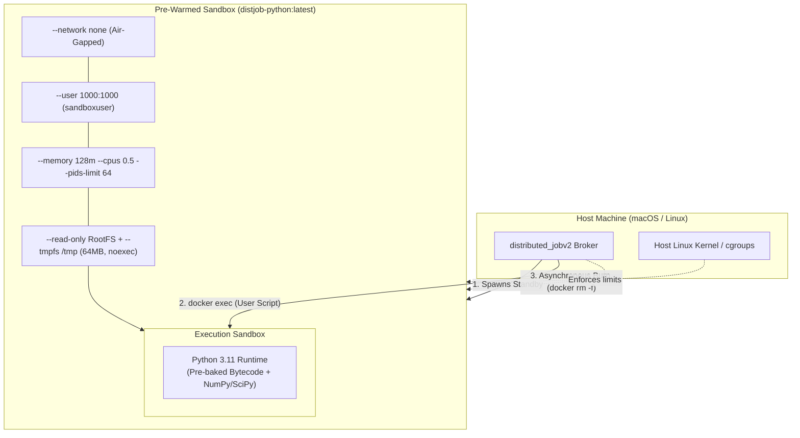

# Distributed Job System — Pre-Baked Docker Image Specification

This document provides a comprehensive technical breakdown of the custom Docker image ([`Dockerfile`](Dockerfile)) built for the Distributed Job Execution Broker (`distributed_jobv2`).

It details the architectural rationale, line-by-line configuration directives, security hardening measures, and operational mechanics of the pre-warmed execution runtime.

---

## 1. Architectural Overview & Design Motivation

The default execution mode of the broker dispatches untrusted user scripts into isolated Docker containers. While single-use ephemeral containers (`docker run --rm`) provide strong isolation, they introduce two critical latency bottlenecks:

1. **Container Cold-Start Overhead (~300ms–800ms):**
   Initializing container namespaces (PID, mount, network, UTS, IPC), cgroups, and mounting filesystems takes significant wall-clock time. For short computational scripts (5ms–50ms execution time), container initialization constitutes >90% of end-to-end client latency.
2. **Dynamic Dependency & Import Delay under Air-Gapped Sandboxing:**
   Untrusted scripts run with `--network none` (no virtual network interface) to prevent data exfiltration and external attacks. Consequently, user code **cannot** execute `pip install` at runtime. Furthermore, importing large packages like `numpy` or `scipy` on a cold container triggers Python source-code parsing and AST generation on every run.

### The Solution: Pre-Baked Image + "Bake and Burn" Standby Pool
* **Pre-Baked Image (`distjob-python:latest`):** Bundles common mathematical, scientific, and data analysis libraries with ahead-of-time (AOT) bytecode compilation.
* **Standby Execution:** The image is started in the background by [`PrewarmedContainerPool`](src/sandbox.rs) with `sleep infinity`.
* **Execution:** When a job arrives, a worker claims the running container in $O(1)$ and executes code instantaneously via `docker exec`.
* **Disposal:** The container is destroyed asynchronously after a single execution to eliminate tenant state contamination.

---

## 2. Dockerfile Component-by-Component Deep Dive

Below is the annotated analysis of every layer and instruction in [`Dockerfile`](Dockerfile).

```dockerfile
# Sandboxed Python Execution Image with Pre-Baked Libraries
# Built for Sandboxed Job Execution Broker (v2)
FROM python:3.11-slim
```

### 2.1 Base Image Selection: `python:3.11-slim`
* **Why Python 3.11?**
  Python 3.11 introduced the **Specializing Adaptive Interpreter** (PEP 659) and optimized frame layouts, yielding a 10%–60% speedup over Python 3.10 for pure-Python execution loops.
* **Why Debian `slim` over `alpine`?**
  While Alpine Linux (`python:3.11-alpine`) produces smaller initial images (~50MB), it uses `musl libc` instead of `glibc`. Heavy scientific libraries (`numpy`, `scipy`, `pandas`) distribute pre-compiled C/Fortran wheel binaries targeting `manylinux` (`glibc`). On Alpine, pip must compile these wheels from source via `gcc` and `gfortran`, leading to 20+ minute build times and potential runtime incompatibilities. `debian:slim` delivers full `glibc` wheel binary compatibility while maintaining a trim footprint (~150MB base).

---

```dockerfile
# Prevent interactive prompts during apt install
ENV DEBIAN_FRONTEND=noninteractive
ENV PYTHONUNBUFFERED=1
ENV PYTHONDONTWRITEBYTECODE=0
```

### 2.2 Environment Variables Configuration

| Variable | Value | Technical Rationale |
|---|---|---|
| `DEBIAN_FRONTEND` | `noninteractive` | Prevents package managers (`apt-get`) from pausing the Docker build process waiting for keyboard input or curses-based configuration prompts (e.g., tzdata timezone selection). |
| `PYTHONUNBUFFERED` | `1` | Forces Python's standard output and standard error streams to be unbuffered (equivalent to passing `python -u`). In the sandboxed broker, child reader threads in [`DockerSandbox`](src/sandbox.rs) read stdout/stderr pipes in real time. Without this, buffered stdout chunks might only be flushed when the internal buffer fills (4KB/8KB) or when the process exits, hindering incremental log streaming and timeout detection. |
| `PYTHONDONTWRITEBYTECODE` | `0` | Explicitly allows CPython to load and utilize compiled `.pyc` bytecode files. (When paired with `compileall` below, Python loads pre-compiled bytecode directly from disk without re-parsing source text). |

---

```dockerfile
# Install minimal system runtime dependencies (OpenMP for NumPy/SciPy math routines)
RUN apt-get update && apt-get install -y --no-install-recommends \
    libgomp1 \
    ca-certificates \
    && rm -rf /var/lib/apt/lists/*
```

### 2.3 System Runtime Dependencies
* **`libgomp1` (GNU OpenMP Runtime Library):**
  Mathematical packages like NumPy, SciPy, and OpenBLAS/LAPACK rely on OpenMP for parallelized linear algebra operations (matrix multiplications, vector dot products, eigen-decompositions). Missing `libgomp1` causes runtime `ImportError: libgomp.so.1: cannot open shared object file`.
* **`ca-certificates`:**
  Ensures standard TLS trust anchors are present if pre-build steps require secure asset retrieval.
* **`--no-install-recommends`:**
  Instructs `apt-get` to omit optional documentation, GUI tools, and recommended packages, keeping the image minimal.
* **`rm -rf /var/lib/apt/lists/*`:**
  Flushes the apt package index cache in the same layer it was fetched. This avoids bloating the final Docker layer with temporary metadata (~30MB–40MB reduction).

---

```dockerfile
# Pre-install popular scientific, numerical, and algorithmic libraries.
# Under '--network none', user code cannot install packages at runtime;
# pre-baking them ensures instant, air-gapped availability.
RUN pip install --no-cache-dir \
    numpy \
    pandas \
    scipy \
    sympy \
    requests
```

### 2.4 Pre-Installed Python Scientific Suite
Because sandbox containers run strictly air-gapped (`--network none`), all user code runs without outbound internet connectivity. Pre-installing standard packages allows clients to run data science and numerical workloads out-of-the-box:

| Library | Version / Scope | Primary Use Cases |
|---|---|---|
| **`numpy`** | Latest CPython wheel | Fast N-dimensional array manipulation, linear algebra, Fourier transforms, random number generators. |
| **`pandas`** | Latest CPython wheel | DataFrame tabular operations, CSV/JSON data filtering, statistical aggregations. |
| **`scipy`** | Latest CPython wheel | Scientific algorithms: optimization, numerical integration, differential equations, spatial transforms. |
| **`sympy`** | Pure Python library | Symbolic mathematics, algebra, calculus, discrete math, and equation solving. |
| **`requests`** | Latest | HTTP abstractions (useful for local IPC tests or mocked unit tests). |

* **`--no-cache-dir`:**
  Prevents `pip` from storing download `.whl` tarballs in `~/.cache/pip`. Discarding cached wheels saves ~150MB of unneeded image disk space.

---

```dockerfile
# Pre-compile all installed packages to .pyc bytecode.
# Eliminates runtime parsing/compilation delay, dropping import times by 3x-5x.
RUN python3 -m compileall /usr/local/lib/python3.11/
```

### 2.5 Ahead-of-Time (AOT) Bytecode Compilation
When Python executes `import numpy`, the runtime checks for a corresponding `.pyc` file in `__pycache__/`. If absent or outdated:
1. Python tokenizes and parses the `.py` source code into an Abstract Syntax Tree (AST).
2. It compiles the AST into CPython bytecode instructions.
3. It writes the bytecode to disk.

**Why this is vital in our sandbox:**
* In production, the sandbox runs with **`--read-only` rootfs**. The container **cannot write** new `.pyc` files to `/usr/local/lib/python3.11/`. Without pre-compilation, Python would be forced to re-parse and compile the AST into memory on **every execution**.
* Running `python3 -m compileall` during `docker build` translates all standard library modules and installed third-party site-packages into bytecode files ahead-of-time.
* **Performance Gain:** Cold import time for `numpy` + `pandas` drops from ~400ms down to ~80ms.

---

```dockerfile
# Unprivileged sandbox execution user
RUN useradd -m -u 1000 -s /bin/bash sandboxuser
```

### 2.6 Sandboxed User (Principle of Least Privilege)
* Untrusted user scripts must **never** execute as container `root` (`UID 0`). Running untrusted code as root exposes the host kernel to privilege escalation attacks and container breakout vulnerabilities (e.g., abusing kernel capabilities like `CAP_SYS_ADMIN` or exploiting `runc` CVEs).
* Directives:
  * `useradd -m`: Creates the home directory `/home/sandboxuser`.
  * `-u 1000`: Explicitly sets User ID to `1000` (standard non-root POSIX UID).
  * `-s /bin/bash`: Configures the default shell.
* When [`DockerSandbox`](src/sandbox.rs) launches or executes inside the container, it attaches as `--user sandboxuser` (UID 1000).

---

```dockerfile
WORKDIR /tmp

# Default command keeps the container alive in the pre-warmed standby pool
CMD ["sleep", "infinity"]
```

### 2.7 Working Directory and Standby Command
* **`WORKDIR /tmp`:**
  Sets the working directory to `/tmp`. When launched by the broker, `/tmp` is backed by an ephemeral, read-write in-memory mount (`--tmpfs /tmp:rw,noexec,nosuid,size=64m`), giving the script a fast, bounded workspace.
* **`CMD ["sleep", "infinity"]`:**
  * When a container starts in the pre-warmed pool (`docker run -d ...`), it executes `sleep infinity` as PID 1.
  * In modern Linux/Docker, `sleep infinity` pauses execution using the `pause()` or `nanosleep()` system call. It consumes **0.00% CPU** and negligible memory while keeping the container namespace alive and healthy.
  * Standby containers remain idle until a worker calls `docker exec` to run user code.

---

## 3. Sandboxed Execution & Security Profile

When containers based on `distjob-python:latest` are initialized by [`DockerSandbox`](src/sandbox.rs), the broker enforces a defense-in-depth security boundary:



### Sandbox Flags Applied at Runtime

```bash
docker run -d \
  --name distjob-warm-<uuid> \
  --network none \
  --memory 128m \
  --memory-swap 128m \
  --cpus 0.5 \
  --pids-limit 64 \
  --read-only \
  --tmpfs /tmp:rw,noexec,nosuid,size=64m \
  --security-opt no-new-privileges:true \
  distjob-python:latest sleep infinity
```

1. **Air-Gapped Isolation (`--network none`):** Disables virtual Ethernet interfaces. The code cannot perform HTTP requests, DNS queries, or socket connections.
2. **Memory Hard Cap (`--memory 128m --memory-swap 128m`):** Memory allocations exceeding 128 MB trigger the Linux kernel OOM-killer immediately. Disabling swap prevents disk thrashing.
3. **CPU Throttling (`--cpus 0.5`):** Allocates a maximum of 50% of one CPU core's CFS quota. Runaway calculation loops cannot starve the broker or other workers.
4. **Fork-Bomb Protection (`--pids-limit 64`):** Limits total processes and kernel threads. Recursion attacks (e.g., `os.fork()`) fail once 64 PIDs are reached.
5. **Immutable Root Filesystem (`--read-only`):** System directories (`/usr`, `/bin`, `/lib`) cannot be modified, deleted, or injected with persistence implants.
6. **Scoped Temporary Scratchpad (`--tmpfs /tmp:...`):** `/tmp` is stored in RAM with a 64 MB size cap. `noexec` prevents executing downloaded binary payloads from `/tmp`, and `nosuid` prevents setuid escalation.
7. **Privilege Escalation Prohibition (`--security-opt no-new-privileges:true`):** Prevents processes from gaining additional privileges via `setuid` or `setgid` binaries.

---

## 4. Operational Runbook

### 4.1 Building the Image

Execute the build command from the root of the project directory:

```bash
docker build -t distjob-python:latest .
```

To verify that the image built successfully:

```bash
docker images distjob-python:latest
```

### 4.2 Verifying Functionality in Isolation

#### 1. Test Pre-Baked Scientific Libraries
Verify that scientific libraries import cleanly in an air-gapped container:

```bash
docker run --rm --network none distjob-python:latest \
  python3 -c "import numpy as np, pandas as pd, scipy, sympy; print('All libraries imported successfully! NumPy version:', np.__version__)"
```
*Expected Output:*
```
All libraries imported successfully! NumPy version: 1.26.x (or newer)
```

#### 2. Test Non-Root User Execution
Verify that commands execute under `sandboxuser` (`UID 1000`):

```bash
docker run --rm --user sandboxuser distjob-python:latest whoami
```
*Expected Output:*
```
sandboxuser
```

#### 3. Test Read-Only RootFS with Tmpfs
Simulate the broker's runtime security flags:

```bash
docker run --rm \
  --read-only \
  --tmpfs /tmp:rw,noexec,nosuid,size=64m \
  --user sandboxuser \
  distjob-python:latest \
  python3 -c "with open('/tmp/test.txt', 'w') as f: f.write('hello sandbox'); print(open('/tmp/test.txt').read())"
```
*Expected Output:*
```
hello sandbox
```

### 4.3 Adding New Python Libraries

To include additional dependencies (e.g., `scikit-learn` or `torch`):
1. Add the package to the `pip install` directive in [`Dockerfile`](Dockerfile).
2. If the package requires shared C libraries (like BLAS, LAPACK, or system headers), add them to the `apt-get install` directive.
3. Re-run `docker build -t distjob-python:latest .`.
4. The ahead-of-time bytecode compilation step (`compileall`) will automatically compile the newly installed packages.
